Enhanced stereo
===============

A molecule's standard stereochemistry says whether a centre is configured, and what
configuration it carries.  **Enhanced stereo** says something additional: whether the
configuration is absolute (one known enantiomer), part of a racemate (both enantiomers
present), or relative (one enantiomer, absolute configuration unknown).  CTfile calls
these collections; chython calls them stereo groups.

The figures on this page are drawn by helpers in a hidden setup block of its source: ``grid`` sets
captioned cells at one scale, and ``wedged`` lays a SMILES out and reads it back from V3000, so its
wedges are stored ones, as a file's are.

.. testsetup::

    from chython import smiles
    from chython.depict import Box, DepictStyle, Group, Path, Scene, Text, TextRun, ValueLabels
    from chython.depict.scene import rounded_box
    from chython.formats import mol as mdl

    def wedged(text):
        """`text` laid out and read back from V3000, so its wedges are stored ones, as a file's are; the
        stereo groups are set again as `text` states them, ids and dead members included."""
        m = smiles(text)
        m.clean2d()
        back = mdl(mdl(m))
        back.clean_stereo_groups()
        with back.edit() as e:
            for (kind, group), members in m.stereo_groups().items():
                for x in members:
                    e.set_stereo_group(x, kind, group)
        return back

    def groups(m):
        """The stored collections as `&2: 2, 5`, one per line, atoms by id."""
        kinds = {1: 'a', 2: 'o', 3: '&'}
        return [f"{kinds[k]}{g if k > 1 else ''}: {', '.join(map(str, v))}"
                for (k, g), v in sorted(m.stereo_groups().items())] or ['no collection']

    def grid(panels, columns=4, ids=False, cip=False):
        """One figure of `(molecule, caption lines)` cells at one scale; the first caption line is bold.
        `ids` numbers every atom, `cip` draws each stored R/S."""
        style = DepictStyle.preset('screen')
        if cip:
            style = style.tuned(**{'atom.stereo_labels': True})
        scenes = []
        for m, lines in panels:
            if not m.has_coordinates:
                m.clean2d()
            overlays = [ValueLabels({n: n for n in m}, fmt='{:.0f}')] if ids else ()
            scenes.append((m.scene(style=style, overlays=overlays), lines))
        columns = min(columns, len(scenes))
        width = max(s.bounds.width for s, _ in scenes) + 1.2
        height = max(s.bounds.height for s, _ in scenes) + .5 + .34 * max(len(lines) for _, lines in scenes)
        children = []
        for i, (scene, lines) in enumerate(scenes):
            row, column = divmod(i, columns)
            x0, y0 = column * width, -row * height
            children.append(Path([rounded_box(Box(x0, y0, x0 + width, y0 + height), .12)], stroke='#dddddd',
                                 width=.02))
            for k, line in enumerate(lines):
                run = TextRun(line, size=.26, weight='bold' if k == 0 else 'normal')
                children.append(Text([run], x=x0 + .2, y=y0 + .25 + .34 * (len(lines) - 1 - k), fill='#444444'))
            box = scene.bounds
            children.append(Group(scene.children).translated(x0 + (width - box.width) / 2. - box.min_x,
                                                             y0 + height - box.height - .25 - box.min_y))
        rows = -(-len(scenes) // columns)
        bounds = Box(-.2, -(rows - 1) * height - .2, columns * width + .2, height + .2)
        return Scene(children, bounds=bounds).to_svg(style=style)

Stereo units
------------

A **stereo unit** is one two-state choice.  Its parity is 1 or 2, stored at the unit's anchor, and 0 is
unset.  ``stereo_units()`` lists every candidate; ``stereogenic_units()`` keeps those whose two states are
two compounds (:doc:`molecule`).

==============  ========  ========================================================================
Kind            ``kind``  Perceived on
==============  ========  ========================================================================
tetrahedral     0         an atom with four directions, a lone pair counting as one: C, Si, Ge,
                          B⁻, N⁺, a tetrahedral metal; S, Se, Te, P, As and Sb with a pair left;
                          N with a pair only in a three-membered ring or at a bridgehead of a
                          short-bridged bicycle.  Never an N-H, a P-H, any other amine, O or Bi
cis/trans       1         a double bond or an even cumulated chain, outside rings smaller than 8;
                          never a bond an alternating cycle can move, and never a labile one: a
                          C=N or N=N with no oxygen on the nitrogen, or a C=C with an O-H or N-H
allene          2         the middle atom of an odd cumulated chain: ``C=C=C``, ``C=C=C=C=C``
atropisomer     3         an acyclic single bond between two hydrogen-free ring atoms, each with an
                          ortho substituent or a ring fusion, the two ortho pairs distinguishable
helical         4         an [n]helicene, n >= 5, of angularly fused six-rings
planar          5         a substituted atom of an η5 ring under a metal, a substituted
                          [2.2]paracyclophane deck atom, or a C=C terminal of a trans-cycloalkene
                          of 8 or 9 ring atoms; the last is dead while the bond is Z
==============  ========  ========================================================================

A labile double bond has a geometry the compound does not keep: E and Z interconvert through nitrogen
inversion or tautomerism, so a sign on an imine, a hydrazone, an azo bond, an enol or a secondary enamine
names the drawing and states nothing.  An oxime, its ether and a nitrone keep theirs, and so does a
tertiary enamine:

.. testcode::

    for e, z in (('C/C=N/C', 'C/C=N\\C'), ('c1ccccc1/N=N/c1ccccc1', 'c1ccccc1/N=N\\c1ccccc1'),
                 ('C/C=C/O', 'C/C=C\\O'), ('C/C=N/OC', 'C/C=N\\OC'), ('C/C=C/N(C)C', 'C/C=C\\N(C)C')):
        print(e, smiles(e) == smiles(z), smiles(e))

.. testoutput::

    C/C=N/C True N(C)=CC
    c1ccccc1/N=N/c1ccccc1 True c1cccc(N=Nc2ccccc2)c1
    C/C=C/O True CC=CO
    C/C=N/OC False C/C=N/OC
    C/C=C/N(C)C False N(/C=C/C)(C)C

Each kind reads and writes as follows.  CXSMILES is the tail ``str(mol)`` writes; plain SMILES is the
``!x`` format spec.

==============  ===========================  ======================  ==========================  ======================
Kind            SMILES                       CXSMILES tail           MOL V2000 / V3000           InChI
==============  ===========================  ======================  ==========================  ======================
tetrahedral     ``@``/``@@``; ``@TH1``/      --                      wedge at the centre, 3D     ``/t``, ``/m``, ``/s``
                ``@TH2`` read                                        coordinates, or the V2000
                                                                     atom parity field
cis/trans       ``/`` and ``\``              --                      coordinates                 ``/b``
allene          ``@``/``@@`` on the middle   --                      wedge from a terminal to    ``/t`` on the middle
                atom; ``@AL1``/``@AL2``                              its substituent             atom
                read
atropisomer     dropped, LOST                ``wU``/``wD`` on a      the same wedge              dropped, no record
                                             ring bond at a pivot
helical         dropped, LOST                ``wU``/``wD`` at a      the same wedge              dropped, LOST
                                             fjord atom
planar          dropped, LOST                ``wU``/``wD`` at the    the same wedge              dropped, LOST
                                             anchor
==============  ===========================  ======================  ==========================  ======================

The three axial-like kinds have no SMILES token, so CXSMILES carries them as wedges in the tail, read
without coordinates, and plain SMILES drops them with one ``smiles:stereo-not-written`` record each.
InChI has no layer for a helix or a planar unit and logs ``inchi:stereo-kind-not-represented``.  The
wedge rules per kind are in `Format support`_.  ``@SP``, ``@TB`` and ``@OH``
are read as unconfigured and logged LOST ``smiles:chiral-class-unsupported``.  The sample is
(+)-butan-2-ol (CID 444683), 2-methoxyphenyl(methyl)phenylphosphine (CID 4643316),
1-chloro-2-methylaziridine (CID 533497), trans-but-2-ene (CID 62695), penta-2,3-diene (CID 136378),
6,6'-dimethylbiphenyl-2,2'-diol (CID 10198261), [6]helicene (CID 98863) and
[2.2]paracyclophane-4-carboxylic acid (CID 4614666), each configured and laid out:

.. testcode::

    from chython.core._core import write_smiles

    KINDS = [('tetrahedral C', 'C[C@H](O)CC'), ('tetrahedral P', 'COc1ccccc1[P@](C)c1ccccc1'),
             ('tetrahedral N', 'C[C@H]1C[N@]1Cl'), ('cis/trans', 'C/C=C/C'), ('allene', 'CC=[C@]=CC'),
             ('atropisomer', 'Cc1cccc(O)c1-c1c(C)cccc1O'), ('helical', 'c1ccc2c(c1)ccc1ccc3ccc4ccc5ccccc5c4c3c12'),
             ('planar', 'OC(=O)c1cc2ccc1CCc1ccc(cc1)CC2')]
    print(f"{'kind':14} {'CXSMILES':9} {'SMILES':7} {'MOL':6} InChI")
    for name, text in KINDS:
        m = smiles(text)
        unit = next(u for u in m.stereogenic_units() if u['kind'] or name.startswith('tetra'))
        if not m.parity_of(unit['anchor']):
            m.set_parity(unit['anchor'], 1)
        m.clean2d()
        flat = write_smiles(m, '!x')
        layers = ''.join(sorted({x[0] for x in m.inchi.split('/')[3:] if x[0] in 'btms'})) or '-'
        records = [r.rule for r in m.log if r.stage == 'inchi']
        print(f'{name:14} {smiles(str(m)) == m!s:9} {smiles(flat) == m!s:7} {mdl(mdl(m)) == m!s:6} {layers} {records}')

.. testoutput::

    kind           CXSMILES  SMILES  MOL    InChI
    tetrahedral C  True      True    True   mst []
    tetrahedral P  True      True    True   mst []
    tetrahedral N  True      True    True   mst []
    cis/trans      True      True    True   b []
    allene         True      True    True   mst []
    atropisomer    True      False   True   - []
    helical        True      False   True   - ['inchi:stereo-kind-not-represented']
    planar         True      False   True   - ['inchi:stereo-kind-not-represented']

A trans-cycloalkene and an extended cis/trans chain do not survive MOL after ``clean2d()``; see
`Limits`_.

The three kinds
---------------

============  ====================  =====================  =========================================
Kind          Atom-member spelling  Bond-member spelling   Meaning
============  ====================  =====================  =========================================
absolute      ``STEABS``            ``STEBABS``            the configuration is as drawn
racemate      ``STERACn``           ``STEBRACn``           AND group *n*: both configurations present
relative      ``STERELn``           ``STEBRELn``           OR group *n*: one configuration, unknown which
============  ====================  =====================  =========================================

For an axis member, ``STERACn`` is used when the chain midpoint is an atom and ``STEBRACn`` when it
is a bond.  An atropisomer axis is written as an atom member on its anchor pivot, since the pivot bond
is single and a ``STEB*`` collection names double bonds; a helix, whose owners are not bonded, is
written as an atom member on its anchor fjord atom.

**STERAC is a racemate, which is AND; STEREL is relative, which is OR.**  The file spells
the chemistry and the API spells the logic, and the two vocabularies do not share a letter.

.. testcode::

    butanol = 'C[C@H](O)CC'
    svg = grid([(smiles(butanol), ['no label', '(S), reliability unstated']),
                (smiles(butanol + ' |a:1|'), ['ABS', '(S), as drawn']),
                (smiles(butanol + ' |&1:1|'), ['AND', '(S) + (R), the racemate']),
                (smiles(butanol + ' |o1:1|'), ['OR', '(S) or (R), one of them'])])

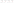

   Butan-2-ol under each kind.  An unlabelled sign is stored and compared, and states nothing about
   its reliability.

Anchor and owners
-----------------

A group is stored at its unit's **anchor** slot, one byte per slot, exactly as a parity is; the
converse holds equally: a byte at a slot is read as the collection of whatever unit anchors there.
pach's bond-group entry keys the collection on the unit's **owners** instead, and a decode resolves
owners back to the anchor once the unit table is built.  The two are not always the same atom.

=========================  ============================  =======================================
Unit                       Owners (how it is named)      Anchor (where the byte lives)
=========================  ============================  =======================================
tetrahedral centre         the centre                    the centre
cis/trans double bond      the two chain terminals       the lower terminal
extended cis/trans         the two chain terminals,      the lower terminal
                           which are not bonded
allene, cumulated even     the two chain terminals       the chain's midpoint ATOM, which is
                                                         neither owner
atropisomer axis           the two pivots                one pivot, not always the lower
helix                      the two fjord atoms, which    one fjord atom, not always the lower
                           are not bonded
planar unit                the substituted ring atom,    the owner
                           or the later C=C terminal
=========================  ============================  =======================================

.. testcode::

    units = [('centre', 'C[C@H](O)CC'), ('cis/trans', 'COC(=O)/C=C/C(=O)OC'),
             ('extended cis/trans', 'C/C=C=C=C/C'), ('allene', 'C[CH]=[C@]=[CH]C'),
             ('atropisomer axis', 'Cc1cccc(O)c1-c1c(C)cccc1O'),
             ('helix', 'c1ccc2c(c1)ccc1ccc3ccc4ccc5ccccc5c4c3c12')]
    cells = []
    for name, text in units:
        m = smiles(text)
        unit = next(u for u in m.stereo_units() if u['stereogenic'])
        if not unit['parity']:
            m.set_parity(unit['anchor'], 1)
        with m.edit() as e:
            e.set_stereo_group(unit['owners'], 3, 1)
        owners = unit['owners'] if isinstance(unit['owners'], tuple) else (unit['owners'],)
        cells.append((m, [name, f"owners {', '.join(map(str, owners))}", f"anchor {unit['anchor']}"]))
    svg = grid(cells, columns=3, ids=True)

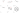

   One unit of each shape in AND 1, atoms numbered.  The label is drawn at the anchor; the
   allene's anchor is its middle atom, which is neither owner.

The anchor is a **slot choice**, not a name: a seal derives the unit table again, so an edit can move a
unit's anchor -- breaking the ring double bond at a biaryl pivot frees that pivot and the axis moves to
it -- and the group byte is migrated with it.  Owners are constitution and survive that, which is why a
wire keys on them.

``stereo_groups()`` spells a one-owner unit as an ``int`` and a two-owner unit as an ascending pair,
and ``bond_stereo_groups()`` is the pair-spelled subset of the same dict -- a view, not a namespace.
``stereo_group_anchor_of(element)`` converts either spelling to the anchor, which is what a format
whose member list is atom-only needs.

A collection stated on an axis is a collection, so both readers see it:

.. testcode::

    from chython import smiles

    mol = smiles('COC(=O)/C=C\\C(=O)OC')
    with mol.edit() as e:
        e.set_bond_stereo_group(5, 6, 2, 1)
    print(mol.stereo_groups())
    print(mol.bond_stereo_groups())
    print(mol.stereo_group_anchor_of((5, 6)))

.. testoutput::

    {(2, 1): [(5, 6)]}
    {(2, 1): [(5, 6)]}
    5

Group ids are labels
--------------------

An id identifies a collection within one record and carries no meaning across records: it is
not a rank, not a count, and two records' ``OR 1`` are unrelated.  Three consequences:

- An id above 63 read from a file is renumbered to the lowest free id of its kind rather than
  dropped, and dropped only when all 63 ids of that kind are already taken.
- There is **one** id space.  A centre and an axis in ``AND 1`` are one collection with two members.
  V3000 spells the two halves ``STERAC1`` and ``STEBRAC1``, so a file that used both for two different
  mixtures has them renumbered apart on read, and an AND or OR collection that needs both spellings is
  split on write with its bond half renumbered (ABS carries no id, so it never splits).  Both are
  logged.
- ``canonical_stereo_groups()`` and ``canonical_bond_stereo_groups()`` assign the ids a caller should
  compare, ranking by member count and then by members' refinement classes ascending.
  ``canonical_bond_stereo_groups()`` is the pair-spelled view of ``canonical_stereo_groups()`` and
  shares its ids.

.. testcode::

    diols = 'C[C@H](O)CC.C[C@H](N)CC'
    cells = [(smiles(f'{diols} |{tail}|'), [tail, note]) for tail, note in [('o1:1,o2:6', 'two pure isomers'),
                                                                           ('o2:1,o1:6', 'the same two'),
                                                                           ('o1:1,6', 'as drawn or both inverted')]]
    first = cells[0][0]
    svg = grid([(m, [*lines, f'== first: {m == first}']) for m, lines in cells], columns=3)

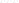

   Swapped ids state the same two isomers.  One OR group over both centres is another
   record: the two are as drawn or both inverted, never one of each.

What identity includes
----------------------

``canonical_bytes``, ``hash(mol)``, ``mol == other`` and ``str(mol)`` read a parity only on a
**stereogenic** unit.  A parity on a unit ``stereogenic_units()`` refuses is stored and ignored:
``C[C@H](C)C`` is isobutane and writes ``C(C)(C)C``, and the writer logs one
``smiles:stereo-not-stereogenic`` record per dropped sign.

.. testcode::

    print(smiles('C[C@H](C)C') == smiles('CC(C)C'), str(smiles('C[C@H](C)C')))

.. testoutput::

    True C(C)(C)C

``canonical_bytes``, ``hash(mol)`` and ``mol == other`` fold each ABS, OR and AND group's **kind and
membership**, atom and bond, and never its id.  ``str(mol)`` is seeded by the same partition.

==================================================  ========
Pair                                                ``==``
==================================================  ========
``C[C@H](O)CC |&1:1|`` and ``C[C@H](O)CC``           False
``C[C@H](O)CC |&1:1|`` and ``C[C@H](O)CC |o1:1|``    False
``C[C@H](O)CC |a:1|`` and ``C[C@H](O)CC``            False
``...|o1:1,o2:3|`` and ``...|o2:1,o1:3|``            True
==================================================  ========

An explicit ABS label counts: a configured centre in no collection is a sign of unknown reliability,
and one labelled ABS is stated absolute.  A group member on a unit that is unconfigured, or not
stereogenic in any combination of AND phases, is **dead**: it states nothing, does not count, and no
writer writes it.  The byte stays stored -- ``copy()`` and pach keep it -- while CXSMILES in every mode,
V2000, V3000 and MRV write the molecule as if it were absent, so ``str(a) == str(b)`` whenever
``a == b`` holds only because of dead members.  A collection with no live member is not written at all.
An AND or OR group whose live members, inverted, restate the molecule in every phase of the other AND
groups -- a meso pair -- states the drawn diastereomer and no enantiomer, which is what ABS states:
``|&1:1,4|``, ``|o1:1,4|`` and ``|a:1,4|`` on ``C[C@H](O)C[C@H](O)C`` are meso-pentane-2,4-diol, written
``|a:1,4|``.  Unlabelled is unknown, so none of them is the unlabelled drawing, which may be either
diastereomer; ``|&1:1,&2:4|`` splits the pair and both groups stay.
``mol.live_stereo_groups()`` answers the written membership in ``canonical_stereo_groups()`` shape,
``mol.dead_stereo_groups()`` the dropped members under their stored ids, and ``mol.stereo_is_live(x)``
one member.

.. testcode::

    racemate = smiles('C[C@H](O)CC |&1:1|')
    print(racemate == smiles('C[C@H](O)CC'), smiles('C[C@H](O)CC |a:1|') == smiles('C[C@H](O)CC'))

.. testoutput::

    False False

.. testcode::

    print(str(smiles('CC(O)CC |o1:1|')), str(smiles('CCCC |a:1|')), str(smiles('C[C@H](C)C |&1:1|')))
    print(smiles('CC(O)CC |o1:1|').stereo_groups(), smiles('CC(O)CC |o1:1|').live_stereo_groups())

.. testoutput::

    C(C)C(O)C C(C)CC C(C)(C)C
    {(2, 1): [2]} {}

Depiction draws what is stored, so a sign on a unit that is not stereogenic is drawn as a wedge that
identity ignores.

.. testcode::

    cells = []
    for text, plain, note in [('C[C@H](C)O', 'CC(C)O', 'a sign, no stereogenic unit'),
                              ('CC(O)CC |o1:1|', 'CC(O)CC', 'an OR on an open centre'),
                              ('C[C@H](O)C[C@H](O)C |&1:1,4|', 'C[C@H](O)C[C@H](O)C', 'a meso pair in one group'),
                              ('C[C@H](O)C[C@H](O)C |&1:1,&2:4|', 'C[C@H](O)C[C@H](O)C', 'the pair split in two')]:
        m = smiles(text)
        cells.append((m, [note, text.split()[-1] if '|' in text else text, f'== unlabelled: {m == smiles(plain)}']))
    svg = grid(cells, columns=4)

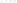

   Each record compared with its unlabelled drawing.  The meso pair in one group states the drawn
   diastereomer, as ABS does, and the split pair states more; the two labels on unconfigured or
   non-stereogenic units state nothing.

Coupled bridgeheads
-------------------

The two bridgeheads of a short-bridged bicycle are one stereo choice: its bridges are too short for
in/out isomers, so both are *out* and one sign implies the other.

=======  ================================================  ==========================================
Family   Bridges                                           Instances
=======  ================================================  ==========================================
bridged  every bridge 1-3 atoms                            camphor, cocaine, pinenes, tropine
fused    one zero bridge, the other two at most 2 atoms    bicyclo[1.1.0]butane, ladderanes
=======  ================================================  ==========================================

=========================================================  ==========================================
Rule                                                       Instance
=========================================================  ==========================================
one signed bridgehead states its partner too, and the      camphor signed at C1 alone is (+)-camphor
writer writes both
two signs no out,out bicycle realises read as unknown in   camphor with C4 inverted is camphor
identity and on write; identity, SMILES and InChI log      unsigned; the stored drawing is kept
``stereo:bridgehead-unrealisable`` once
``validate_stereo()`` clears such a pair, or with          the cleared pair, or the racemate of
``recover_racemate`` reads it as the racemate              (+)-camphor
a set whose inversion restates the molecule states         adamantane signed out,out is adamantane
nothing
a set is one element: it takes the strongest label of      ``|&1:4|`` and ``|a:1,&1:4|`` on camphor
its signed members -- AND, OR, ABS, none -- two groups     are ``|&1:1,4|``, written so
of one kind on it merge, and it is written on every
member
a nitrogen bridgehead of a bridged bicycle is a            Tröger's base; indolizidine's fused N
lone-pair centre; a fused one is not                       inverts
=========================================================  ==========================================

``stereo_units()`` names the other anchors of a unit's set under ``coupled``, ``()`` for a free unit.
InChI is written from the same reading, so equal drawings write one InChI; a set that states nothing
writes ``?``, as PubChem's (2R)-bicyclo[2.2.2]octane-2-carboxylic acid (CID 6928769) does in
``/t6?,7?,8-``.

.. testcode::

    camphor = smiles('C[C@@]12CC[C@@H](C1(C)C)CC2=O')
    half, inverted = smiles('C[C@@]12CCC(C1(C)C)CC2=O'), smiles('C[C@@]12CC[C@H](C1(C)C)CC2=O')
    print(half == camphor, str(half))
    print(inverted == smiles('CC12CCC(C1(C)C)CC2=O'), [r.rule for r in inverted.log])
    print(str(smiles('C[C@@]12CC[C@@H](C1(C)C)CC2=O |&1:1|')), camphor.unit_of(2)['coupled'])

.. testoutput::

    True C1[C@H]2CC[C@@](C)(C1=O)C2(C)C
    True ['stereo:bridgehead-unrealisable']
    C1[C@@H]2CC[C@](C)(C1=O)C2(C)C |&1:1,4| (5,)

.. testcode::

    camphor = smiles('C[C@@]12CC[C@@H](C1(C)C)CC2=O')
    cells = []
    for text, note in [('C[C@@]12CC[C@@H](C1(C)C)CC2=O', '(+)-camphor, both signed'),
                       ('C[C@@]12CCC(C1(C)C)CC2=O', 'C1 signed alone'),
                       ('C[C@@]12CC[C@H](C1(C)C)CC2=O', 'C4 inverted'),
                       ('CC12CCC(C1(C)C)CC2=O', 'unsigned')]:
        m = smiles(text)
        cells.append((m, [note, f'== (+)-camphor: {m == camphor}', f'coupled {m.unit_of(2)["coupled"]}']))
    svg = grid(cells, columns=4, ids=True)

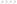

   Camphor (CID 2537).  C2 and C5 are one choice: one sign states both, two signs no out,out bicycle
   realises state neither, and the inverted drawing equals the unsigned one.

The unrealisable record is logged once per molecule, at stage ``stereo``, whichever answer asks first;
the stored parities are kept as drawn:

.. testcode::

    bad = smiles('C[C@@]12CC[C@H](C1(C)C)CC2=O')
    str(bad), hash(bad), bad == camphor, bad.inchi
    print([(r.rule, r.severity, r.stage) for r in bad.log], bad.parity_of(2), bad.parity_of(5))

.. testoutput::

    [('stereo:bridgehead-unrealisable', 'lost', 'stereo')] 1 2

``validate_stereo()`` -- step 2 of ``canonicalize()`` -- also heals a stereogenic unit with no sign, a wavy
bond, alone in an AND group: a racemate whatever its sign, it takes one and keeps the group, logged REPAIRED
``stereo:racemate-unsigned``.  An unsigned member sharing its group is left, its relation to the others
unknown.

An unrealisable pair whose signed members are all in AND groups holding nothing else is stated racemic,
and its relation to the rest of the molecule is stated by nothing, so either realisable signing says the
same: ``validate_stereo()`` heals it into the lowest of those groups, logged REPAIRED
``stereo:bridgehead-racemate``.  An AND group shared with another centre is not healed by default -- for a
norbornene imide the choice would put the imide exo or endo.

Any other unrealisable pair ``validate_stereo()`` clears from the stored molecule and logs the same rule, so the drawing no longer carries what no bicycle builds.  A drawer who signed both
bridgeheads that way most likely meant the racemate; ``recover_racemate=True`` reads it so, giving the
pair its realisable signing in a new AND group, logged REPAIRED ``stereo:bridgehead-racemate``:

.. testcode::

    cleared, recovered = smiles('C[C@@]12CC[C@H](C1(C)C)CC2=O'), smiles('C[C@@]12CC[C@H](C1(C)C)CC2=O')
    print(cleared.validate_stereo(), cleared == smiles('CC12CCC(C1(C)C)CC2=O'))
    print(recovered.validate_stereo(recover_racemate=True), str(recovered))
    print([(r.rule, r.severity) for r in recovered.log if r.rule == 'stereo:bridgehead-racemate'])

.. testoutput::

    [2, 5] True
    [] C1[C@@H]2CC[C@](C)(C1=O)C2(C)C |&1:1,4|
    [('stereo:bridgehead-racemate', 'repaired')]

A nitrogen bridgehead of a bridged bicycle couples the same way.  Quinine (CID 3034034) is drawn with
its quinuclidine nitrogen unsigned; the writer states the sign the bicycle implies, and the other sign
is unrealisable, so it clears the pair:

.. testcode::

    quinine = smiles('COc1ccc2nccc([C@@H](O)[C@@H]3C[C@@H]4CCN3C[C@@H]4C=C)c2c1')
    print(str(quinine), quinine.parity_of(18), quinine.unit_of(18)['coupled'])
    impossible = smiles(str(quinine).replace('[N@@]', '[N@]'))
    print(str(impossible), [r.rule for r in impossible.log])
    print(impossible == smiles(str(quinine).replace('[N@@]', 'N').replace('[C@H]2', 'C2')))

.. testoutput::

    C1C[C@H]2C[C@@H]([C@@H](c3ccnc4ccc(cc34)OC)O)[N@@]1C[C@@H]2C=C 0 (15,)
    C1CC2C[C@@H]([C@@H](c3ccnc4ccc(cc34)OC)O)N1C[C@@H]2C=C ['stereo:bridgehead-unrealisable']
    True

Spiro centres and alkylidene terminals
--------------------------------------

The spiro atom of a 2,6-disubstituted spiro[3.3]heptane or a 3,9-disubstituted spiro[5.5]undecane, and
the C=C of a 4-substituted cyclohexylidene, are the axis of an axially chiral molecule whose far ends are
centres.  Each is a stereo unit of its own -- a tetrahedral spiro atom, a cis/trans bond -- and so is
each terminal, and all of them are stereogenic.

======================================================  ====================================================
Rule                                                    Instance
======================================================  ====================================================
a terminal's sign counts only when the axis is          both acid carbons of spiro[3.3]heptane-2,6-
configured: the spiro centre, or the C=C                dicarboxylic acid signed, the spiro atom not, is
                                                        the unsigned compound and writes no sign
with the axis signed, every sign is written and         inverting one acid carbon gives the enantiomer;
compared                                                inverting both is the same compound
======================================================  ====================================================

.. testcode::

    SPIRO = 'OC(=O)[C%sH]1C[C%s]2(C[C%sH](C(=O)O)C2)C1'        # C3, the spiro C5 and C7, 0 unsigned
    plain = smiles(SPIRO % ('', '', ''))
    drawn = smiles(SPIRO % ('@', '@', '@'))
    print(f"{'C3 C5 C7':12} {'== plain':9} {'== @ @ @':9} str")
    for signs in [('@', '', '@'), ('@', '', '@@'), ('@', '@', '@'), ('@', '@', '@@'), ('@@', '@', '@@')]:
        m = smiles(SPIRO % signs)
        print(f"{' '.join(x or '0' for x in signs):12} {m == plain!s:9} {m == drawn!s:9} {m}")

.. testoutput::

    C3 C5 C7     == plain  == @ @ @  str
    @ 0 @        True      False     OC(=O)C1CC2(CC(C(=O)O)C2)C1
    @ 0 @@       True      False     OC(=O)C1CC2(CC(C(=O)O)C2)C1
    @ @ @        False     True      OC(=O)[C@@H]1C[C@]2(C[C@@H](C(=O)O)C2)C1
    @ @ @@       False     False     OC(=O)[C@@H]1C[C@]2(C[C@H](C(=O)O)C2)C1
    @@ @ @@      False     True      OC(=O)[C@@H]1C[C@]2(C[C@@H](C(=O)O)C2)C1

The cyclohexylidene's axis is its C=C, configured here through ``set_parity`` on its anchor:

.. testcode::

    ACID = 'C[C%sH]1CCC(=CC(=O)O)CC1'                     # the C=C is anchored at atom 5
    plain = smiles(ACID % '')
    terminal = smiles(ACID % '@')
    axis = smiles(ACID % '@')
    axis.set_parity(5, 1)
    print(terminal == plain, str(terminal))
    print(axis == plain, str(axis))

.. testoutput::

    True C(C(O)=O)=C1CCC(C)CC1
    False C(/C(O)=O)=C/1\CC[C@H](C)CC1

.. testcode::

    unsigned = smiles(SPIRO % ('', '', ''))
    cells = []
    for signs, note in [(('@', '', '@'), 'terminals signed'), (('@', '@', '@'), 'spiro atom signed too')]:
        m = smiles(SPIRO % signs)
        cells.append((m, [note, f'== unsigned: {m == unsigned}']))
    cells += [(terminal, ['terminal signed', f'== unsigned: {terminal == plain}']),
              (smiles(str(axis)), ['C=C configured too', f'== unsigned: {axis == plain}'])]
    svg = grid(cells, columns=4)

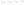

   Spiro[3.3]heptane-2,6-dicarboxylic acid (CID 240836) and (4-methylcyclohexylidene)acetic acid
   (CID 4169398).  A terminal's sign states nothing until the axis between the terminals is configured.

Signs inside a group
--------------------

**An AND group's signs are relative; an OR group's signs name the isomer.**

- **AND** is a racemate.  Inverting every member states the same mixture, so identity and ``str(mol)``
  read the group in one canonical phase.  Inverting some members and not others is another
  diastereomer.  An AND group of one member carries no parity: ``C[C@H](O)CC |&1:1|`` is racemic
  butan-2-ol whichever enantiomer it is drawn from.
- **OR** is one pure isomer whose absolute configuration is unknown.  The drawn signs tell two isolated
  isomers apart, so they are kept as drawn: inverting an OR group gives the other isomer, and an OR
  group of one member keeps its sign.

Only a mirror symmetry makes the inverted signs the same compound, since a meso form is its own mirror
image.  A C2 axis is not a mirror: trans-cyclohexane-1,2-diol is chiral, and its two OR drawings are
its two enantiomers.

================================================================  ======  ======  =============
Pair, second drawing with every group member's sign inverted      ``&1``  ``o1``  ``*1`` = none
================================================================  ======  ======  =============
butan-2-ol ``C[C@H](O)CC |*1:1|``                                 True    False   False
pseudoephedrine ``C[C@H](NC)[C@@H](O)c1ccccc1 |*1:1,4|``          True    False   False
trans-cyclohexane-1,2-diol ``O[C@@H]1CCCC[C@H]1O |*1:1,6|``       True    False   False
cis-cyclohexane-1,2-diol ``O[C@@H]1CCCC[C@@H]1O |*1:1,6|``, meso  True    True    False
================================================================  ======  ======  =============

``*1`` stands for the group in the column; ``*1`` = none compares the labelled drawing with the unlabelled
one under ``&1``, ``o1`` and ``a`` alike.  Unlabelled is unknown, so a label is never the unlabelled
drawing, the meso form's included: there the three kinds state one thing, the drawn diastereomer, and are
written ``|a:...|``.  Inverting one member of a two-member group is unequal under both kinds:
pseudoephedrine becomes ephedrine.

.. testcode::

    def inverted(text):
        return text.replace('@@', '#').replace('@', '@@').replace('#', '@')

    for kind in ('&1', 'o1'):
        drawn = f'C[C@H](NC)[C@@H](O)c1ccccc1 |{kind}:1,4|'
        print(kind, smiles(drawn) == smiles(inverted(drawn)), str(smiles(drawn)))
    cis = 'O[C@@H]1CCCC[C@@H]1O'
    labelled = {str(smiles(f'{cis} |{kind}:1,6|')) for kind in ('&1', 'o1', 'a')}
    print(labelled, smiles(f'{cis} |&1:1,6|') == smiles(cis))

.. testoutput::

    &1 True N([C@H](C)[C@@H](c1ccccc1)O)C |&1:1,3|
    o1 False N([C@@H](C)[C@H](c1ccccc1)O)C |o1:1,3|
    {'C1C[C@@H]([C@H](O)CC1)O |a:2,3|'} False

.. testcode::

    def inverted(text):
        return text.replace('@@', '#').replace('@', '@@').replace('#', '@')

    cells = []
    for name, text in [('butan-2-ol', 'C[C@H](O)CC |*1:1|'),
                       ('pseudoephedrine', 'C[C@H](NC)[C@@H](O)c1ccccc1 |*1:1,4|'),
                       ('trans-cyclohexane-1,2-diol', 'O[C@@H]1CCCC[C@H]1O |*1:1,6|'),
                       ('cis-cyclohexane-1,2-diol', 'O[C@@H]1CCCC[C@@H]1O |*1:1,6|')]:
        for kind in ('&1', 'o1'):
            one, other = smiles(text.replace('*1', kind)), smiles(inverted(text).replace('*1', kind))
            cells += [(one, [name, kind]), (other, [f'{kind} inverted', f'== drawn: {one == other}'])]
    svg = grid(cells, columns=4)

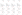

   The table above, drawn.  An inverted AND drawing is the same racemate; an inverted OR drawing
   is the other isomer unless the molecule is meso.

**An AND group on a double bond states both geometries.**  Its two phases are E and Z, so dimethyl
maleate in ``AND 1`` and dimethyl fumarate in ``AND 1`` are one E + Z mixture and write one string,
in the canonical phase.  An OR group on a double bond keeps its drawn geometry, as on a centre.

.. testcode::

    #: dimethyl maleate laid out cis by hand, atoms as numbered in 'COC(=O)/C=C\C(=O)OC'
    CIS = {1: (-1, 2.598), 2: (-.5, 1.732), 3: (-1, .866), 4: (-2, .866), 5: (-.5, 0),
           6: (.5, 0), 7: (1, .866), 8: (2, .866), 9: (.5, 1.732), 10: (1, 2.598)}

    def maleate(tail=''):
        m = smiles(f'COC(=O)/C=C\\C(=O)OC {tail}'.strip())
        with m.edit() as e:
            for n, (x, y) in CIS.items():
                e.set_xy(n, x, y)
        return m

    fumarate = smiles('COC(=O)/C=C/C(=O)OC |&1:4|')
    cells = [(maleate(), ['dimethyl maleate', 'Z']), (smiles('COC(=O)/C=C/C(=O)OC'), ['dimethyl fumarate', 'E']),
             (maleate('|&1:4|'), ['maleate, &1', 'Z + E', f'== fumarate &1: {maleate("|&1:4|") == fumarate}']),
             (fumarate, ['fumarate, &1', 'E + Z', f'str: {fumarate}'])]
    svg = grid(cells, columns=4)

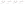

   Maleate and fumarate, plain and in AND 1.  The maleate is laid out by hand.

``canonical_bond_stereo_group_ambiguities()`` reports two groups the colouring cannot
separate, and it errs toward reporting: a caller may be told two ids are unreliable where
the molecule's symmetry could not in fact exchange them.  A caller loses a guarantee and
never gets a wrong answer.

Racemates and relative stereo: pitfalls
---------------------------------------

Each row is one pair the sample below compares; ``str`` is what each side writes.

===  ===============================================  ======  ===============================================
Row  Pitfall                                          ``==``  Reading
===  ===============================================  ======  ===============================================
1    a one-member ``&1`` on either enantiomer         True    racemic butan-2-ol from both drawings; the sign
                                                              is written in one canonical phase
2    ``&1`` on an unsigned centre                     True    a dead member: the record is the unsigned one
3    ``&1`` against the unsigned drawing              False   a racemate is a statement; no sign is not one
4    two AND groups in one component, one member      True    each centre is racemic on its own, so all four
     inverted                                                 isomers are present either way
5    the same record against the unsigned drawing     False
6    one AND group over both centres, one member      False   the pseudoephedrine racemate against the
     inverted                                                 ephedrine one
7    OR on one centre, the two enantiomers            False   OR keeps its sign: two isolated isomers
8    explicit ABS against no label                    False   an explicit ABS label is identity
9    no label against ``o1``                          False   no label states the sign with unknown
                                                              reliability, which is neither ABS nor OR
10   no label against the unsigned drawing            False   an unlabelled sign is stored and compared
===  ===============================================  ======  ===============================================

Rows 4 to 6 are (+)-pseudoephedrine, ``C[C@H](NC)[C@@H](O)c1ccccc1`` (CID 7028).

.. testcode::

    PE = 'C[C@H](NC)[C@%sH](O)c1ccccc1'                 # '' inverts C4, '@' keeps it
    PAIRS = [('C[C@H](O)CC |&1:1|', 'C[C@@H](O)CC |&1:1|'), ('CC(O)CC |&1:1|', 'CC(O)CC'),
             ('C[C@H](O)CC |&1:1|', 'CC(O)CC'), (PE % '@' + ' |&1:1,&2:4|', PE % '' + ' |&1:1,&2:4|'),
             (PE % '@' + ' |&1:1,&2:4|', 'CC(NC)C(O)c1ccccc1'), (PE % '@' + ' |&1:1,4|', PE % '' + ' |&1:1,4|'),
             ('C[C@H](O)CC |o1:1|', 'C[C@@H](O)CC |o1:1|'), ('C[C@H](O)CC |a:1|', 'C[C@H](O)CC'),
             ('C[C@H](O)CC', 'C[C@H](O)CC |o1:1|'), ('C[C@H](O)CC', 'CC(O)CC')]
    for row, (left, right) in enumerate(PAIRS, 1):
        a, b = smiles(left), smiles(right)
        print(f'{row:<2} {a == b!s:5} {a!s:40} {b}')

.. testoutput::

    1  True  C(C)[C@H](O)C |&1:2|                     C(C)[C@H](O)C |&1:2|
    2  True  C(C)C(O)C                                C(C)C(O)C
    3  False C(C)[C@H](O)C |&1:2|                     C(C)C(O)C
    4  True  N([C@H](C)[C@H](c1ccccc1)O)C |&1:3,&2:1| N([C@H](C)[C@H](c1ccccc1)O)C |&1:3,&2:1|
    5  False N([C@H](C)[C@H](c1ccccc1)O)C |&1:3,&2:1| N(C(C)C(c1ccccc1)O)C
    6  False N([C@H](C)[C@@H](c1ccccc1)O)C |&1:1,3|   N([C@H](C)[C@H](c1ccccc1)O)C |&1:1,3|
    7  False C(C)[C@@H](O)C |o1:2|                    C(C)[C@H](O)C |o1:2|
    8  False C(C)[C@@H](O)C |a:2|                     C(C)[C@@H](O)C
    9  False C(C)[C@@H](O)C                           C(C)[C@@H](O)C |o1:2|
    10 False C(C)[C@@H](O)C                           C(C)C(O)C

Storing the canonical labelling
-------------------------------

``str(mol)`` writes the collections in their canonical labelling from a private copy; the stored
ids and signs are kept.  ``mol.canonicalize_stereo_groups()`` stores that labelling, so every writer,
``stereo_groups()``, ``to_bytes()`` and pach then carry it.  ``==``, ``hash``, ``canonical_bytes`` and
``str(mol)`` do not move.  It returns whether anything changed, and a second call returns False.

=====================  =====================================================================
Step                   Rewrite
=====================  =====================================================================
dead members           dropped, with their parity where the unit is not stereogenic
relabelling            the least labelling of the same meaning
AND phase              each AND collection inverted into its canonical phase
ids                    OR and AND ids numbered canonically per kind
=====================  =====================================================================

Ids and phases are read in atom order, and a molecule read from ``str(mol)`` has its atoms in written
order, so that read-back is already canonical.  An inverted unit's stored wedges and its ``R``/``S`` are
inverted with it; any other descriptor on it, and a wedge on a unit left unconfigured, are dropped and
logged.  Until the method runs, ``live_stereo_groups()`` is the labelling that pairs with the stored
signs, which is what V2000, V3000 and MRV write; ``str(mol)`` may hold an AND collection in its other
phase to state fewer labels, as on ``C[C@H](O)[C@H](O)[C@@H](O)C |&1:3,5|``, written with C3 as ABS.

Each changed atom is one INFO record on ``mol.log`` at stage ``stereo-groups``.  It is the last stage of
``canonicalize()``; ``canonicalize(stereo_groups=False)`` skips it, and ``ReactionContainer.canonicalize()``
skips it for every molecule, since a racemic input's drawn sign against the product's can tell retention
from inversion.

.. testcode::

    one, other = smiles('C[C@H](O)CC |&1:1|'), smiles('C[C@@H](O)CC |&2:1|')
    print(one == other, one.stereo_groups(), other.stereo_groups())
    print(one.canonicalize_stereo_groups(), other.canonicalize_stereo_groups(), other.canonicalize_stereo_groups())
    print(one.to_bytes() == other.to_bytes(), other.stereo_groups(), format(other, 'i'), str(other))

.. testoutput::

    True {(3, 1): [2]} {(3, 2): [2]}
    False True False
    True {(3, 1): [2]} C[C@H](O)CC |&1:1| C(C)[C@H](O)C |&1:2|

.. testcode::

    def canonical(m):
        """A copy of `m` after `canonicalize_stereo_groups()`, and the rules it logged."""
        after = m.copy()
        after.canonicalize_stereo_groups()
        return after, sorted({r.rule.split(':')[1] for r in after.log.by_stage('stereo-groups')})

    butanol = wedged('C[C@@H](O)CC |&2:1|')
    butanol.assign_cip()
    pseudoephedrine = wedged('C[C@@H](NC)[C@H](O)c1ccccc1 |&1:1,4|')
    with pseudoephedrine.edit() as e:
        e.set_atom_cip(2, 'R')
    triol = wedged('C[C@@H](O)[C@H](O)[C@@H](O)C |&1:1,&2:5,o1:3|')
    cells = []
    for m in (butanol, pseudoephedrine, triol):
        after, rules = canonical(m)
        cells += [(m, ['drawn']), (after, ['stored', ', '.join(rules)])]
    svg = grid(cells, columns=2, cip=True)

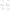

   Before and after, stored R/S drawn.  Butan-2-ol: ``&2`` becomes ``&1`` in the other phase, its
   wedge and (R) inverted with it.  (1R,2R)-Pseudoephedrine: the other phase is (1S,2S), and the stored
   (R) on C2 is dropped, since ``assign_cip()`` leaves that centre undecided.  The meso triol:
   C3 is dead, so its parity and its wedge are dropped.

The method moves signs, wedges and descriptors, never coordinates.  A double bond inverted into its
canonical phase keeps the geometry it was drawn with, so its parity and its coordinates disagree, and
depiction draws it crossed and logs ``depict:crossed-contradiction``.

.. testcode::

    after = maleate('|&1:4|')
    after.canonicalize_stereo_groups()
    log = []
    after.depict(log=log)
    cells = [(maleate('|&1:4|'), ['drawn', 'cis parity, cis coordinates']),
             (after, ['stored', 'trans parity, cis coordinates', *sorted({r.rule for r in log})])]
    svg = grid(cells, columns=2)

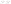

   Dimethyl maleate in AND 1, before and after.  The canonical phase is E; the coordinates
   are still Z.

Meso forms and pseudo-asymmetric centres
----------------------------------------

A meso form is its own mirror image.  Its centres are stereogenic -- inverting one gives another
compound -- while inverting all of them restates it, so every collection over all of them states the drawn
diastereomer as ABS does.  Unlabelled is unknown: the labelled meso form is not the unlabelled drawing.

==============================================  ==============================================================
Rule                                            meso-Tartaric acid (CID 447315)
==============================================  ==============================================================
the full inversion is the same compound         ``==`` its inversion is True; L-tartaric acid (CID 444305)
                                                inverted is D-tartaric acid
``&1``, ``o1`` or ``a`` over both centres       one compound, written ``|a:...|``; not the unlabelled drawing
a collection over one centre                    live: ``|&1:0|`` is the meso form mixed with one enantiomer
``assign_cip()``                                R and S
==============================================  ==============================================================

A **pseudo-asymmetric** centre carries two constitutionally equal ligands of opposite configuration, so it
is stereogenic only while those two differ.  The pentane-2,3,4-triol handbook below enumerates one: its C3
is ``r`` or ``s`` in the two meso forms and states nothing in the chiral pair.  ``assign_cip()`` gives such
a centre no descriptor and logs ``cip:undecided`` (:doc:`molecule`).

.. testcode::

    def inverted(text):
        return text.replace('@@', '#').replace('@', '@@').replace('#', '@')

    MESO, L = '[C@@H]([C@@H](C(=O)O)O)(C(=O)O)O', '[C@@H]([C@H](C(=O)O)O)(C(=O)O)O'
    meso = smiles(MESO)
    print(meso == smiles(inverted(MESO)), smiles(inverted(L)) == smiles(L), str(meso))
    for tail in ('&1:0,1', 'o1:0,1', 'a:0,1', '&1:0'):
        m = smiles(f'{MESO} |{tail}|')
        print(f'{tail:7} {m == meso!s:5} {m}')
    meso.assign_cip()
    print([meso.atom(n).cip for n in (1, 2)])

.. testoutput::

    True False C([C@@H](O)[C@H](C(O)=O)O)(=O)O
    &1:0,1  False C([C@@H](O)[C@H](C(O)=O)O)(=O)O |a:1,3|
    o1:0,1  False C([C@@H](O)[C@H](C(O)=O)O)(=O)O |a:1,3|
    a:0,1   False C([C@@H](O)[C@H](C(O)=O)O)(=O)O |a:1,3|
    &1:0    False C(O)([C@H]([C@@H](C(O)=O)O)O)=O |&1:2|
    ['R', 'S']

.. testcode::

    triol = smiles('C[C@H](O)[C@H](O)[C@H](O)C')
    triol.assign_cip()
    cells = [(smiles(MESO), ['meso-tartaric acid', f'== inverted: {smiles(MESO) == smiles(inverted(MESO))}']),
             (smiles(L), ['L-tartaric acid', f'== inverted: {smiles(L) == smiles(inverted(L))}']),
             (meso, ['meso-tartaric acid', 'R, S']),
             (triol, ['ribo-pentane-2,3,4-triol', 'C3 pseudo-asymmetric, no descriptor'])]
    svg = grid(cells, columns=4, cip=True)

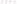

   meso- and L-tartaric acid against their inversions, and the stored descriptors of a meso form and of
   a pseudo-asymmetric centre.

Handbook: pentane-2,3,4-triol
-----------------------------

Pentane-2,3,4-triol, ``CC(O)C(O)C(O)C``, is the smallest molecule where every rule above bites at once:
two constitutionally equivalent centres, C2 and C4, and between them a pseudo-asymmetric C3 that is
stereogenic only when C2 and C4 differ.  This section enumerates every drawing of it and every labelling
of every drawing, and prints what each states and what ``str()`` writes for it.  The helpers ``zigzag``
(the chain on one zigzag, each OH off it so every wedge sits on a C-O bond) and ``grid`` (one figure of
captioned cells at one scale) are in a hidden setup block of this page's source.

.. testsetup::

    from itertools import product

    def zigzag(text):
        """The triol on one zigzag with every OH off the chain, so each wedge sits on a C-O bond."""
        m = smiles(text)
        carbon = {n for n in m.atom_numbers if m.atom(n).atomic_symbol == 'C'}
        chain = [min(n for n in carbon if m.degree_of(n) == 1)]
        while len(chain) < 5:
            chain.append(next(n for n in m.neighbors_of(chain[-1]) if n in carbon and n not in chain))
        oxygen = {n: [o for o in m.neighbors_of(n) if o not in carbon] for n in chain}
        with m.edit() as e:
            for i, n in enumerate(chain):
                y = .5 * (i % 2)
                e.set_xy(n, .866 * i, y)
                for o in oxygen[n]:
                    e.set_xy(o, .866 * i, y + (1. if i % 2 else -1.))
        return m

The four stereoisomers
~~~~~~~~~~~~~~~~~~~~~~

The names are the carbohydrate configurational prefixes for three contiguous centres; D and L are the
two arabino enantiomers.

==========  ============  ==================================  ======  =====================================
Name        CIP           SMILES                              Chiral  C3
==========  ============  ==================================  ======  =====================================
ribo        (2R,3s,4S)    ``C[C@H](O)[C@H](O)[C@H](O)C``      no      pseudo-asymmetric, ``s``
xylo        (2R,3r,4S)    ``C[C@H](O)[C@@H](O)[C@H](O)C``     no      pseudo-asymmetric, ``r``
D           (2R,4R)       ``C[C@@H](O)[C@H](O)[C@H](O)C``     yes     not stereogenic: its sign states nothing
L           (2S,4S)       ``C[C@H](O)[C@H](O)[C@@H](O)C``     yes     not stereogenic: its sign states nothing
==========  ============  ==================================  ======  =====================================

Eight sign combinations name four isomers: each meso form is its own mirror image, and D or L is
drawn with either sign at C3.

.. testcode::

    TRIOL = 'C[C%sH](O)[C%sH](O)[C%sH](O)C'           # C2, C3 and C4 are SMILES atoms 1, 3 and 5
    ISOMERS = {'ribo': ('@', '@', '@'), 'xylo': ('@', '@@', '@'), 'D': ('@@', '@', '@'), 'L': ('@', '@', '@@')}
    NAME = {str(smiles(TRIOL % signs)): name for name, signs in ISOMERS.items()}

    def isomer(signs):
        return NAME[str(smiles(TRIOL % signs))]

    for signs in product(['@', '@@'], repeat=3):
        print(f'{TRIOL % signs:32} {isomer(signs)}')
    svg = grid([(zigzag(TRIOL % signs), [name]) for name, signs in ISOMERS.items()])

.. testoutput::

    C[C@H](O)[C@H](O)[C@H](O)C       ribo
    C[C@H](O)[C@H](O)[C@@H](O)C      L
    C[C@H](O)[C@@H](O)[C@H](O)C      xylo
    C[C@H](O)[C@@H](O)[C@@H](O)C     L
    C[C@@H](O)[C@H](O)[C@H](O)C      D
    C[C@@H](O)[C@H](O)[C@@H](O)C     xylo
    C[C@@H](O)[C@@H](O)[C@H](O)C     D
    C[C@@H](O)[C@@H](O)[C@@H](O)C    ribo

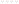

   The four isomers, drawn by ``zigzag``.

Drawings without labels
~~~~~~~~~~~~~~~~~~~~~~~

A drawing with no enhanced stereo states each drawn sign absolutely and nothing about an unsigned
centre, so it is a set of isomers the compound may be.  The 27 drawings, each centre ``@``, ``@@`` or
unsigned, state 12 such sets, and each set writes one string.

.. testcode::

    ORDER = list(ISOMERS)

    def listed(names):
        return ', '.join(sorted(names, key=ORDER.index))

    def may_be(signs):
        """Every isomer a drawing admits: an unconfigured centre ('') takes either sign."""
        return frozenset(isomer(tuple(s or f for s, f in zip(signs, fill))) for fill in product(['@', '@@'], repeat=3))

    plain = {}
    for signs in product(['@', '@@', ''], repeat=3):
        plain.setdefault(may_be(signs), set()).add(str(smiles(TRIOL % signs)))
    plain = sorted(plain.items(), key=lambda kv: (len(kv[0]), sorted(ORDER.index(x) for x in kv[0])))
    print(len(plain), 'meanings,', sum(len(written) for _, written in plain), 'strings')
    for names, (written,) in plain:
        print(f'{listed(names):26} {written}')
    svg = grid([(zigzag(written), [listed(names)]) for names, (written,) in plain])

.. testoutput::

    12 meanings, 12 strings
    ribo                       [C@H]([C@@H]([C@@H](C)O)O)(O)C
    xylo                       [C@H]([C@H]([C@@H](C)O)O)(O)C
    D                          [C@@H](O)(C)C(O)[C@@H](C)O
    L                          [C@H](O)(C)C(O)[C@H](C)O
    ribo, xylo                 [C@H](C([C@@H](C)O)O)(O)C
    ribo, D                    [C@@H]([C@H](C(C)O)O)(O)C
    ribo, L                    [C@H]([C@@H](C(C)O)O)(O)C
    xylo, D                    [C@@H]([C@@H](C(C)O)O)(O)C
    xylo, L                    [C@H]([C@H](C(C)O)O)(O)C
    ribo, xylo, D              [C@@H](C(C(C)O)O)(O)C
    ribo, xylo, L              [C@H](C(C(C)O)O)(O)C
    ribo, xylo, D, L           C(O)(C)C(O)C(C)O

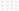

   The twelve plain meanings, each captioned with the isomers it may be.

Labelled drawings
~~~~~~~~~~~~~~~~~

Each of the three centres is ABS, in an AND group or in an OR group, which is 47 labellings up to group
ids, on each of the four isomers.  A labelling's meaning is read by the rules of the sections above:

====================  ==================================================================================
Notation              States
====================  ==================================================================================
``ribo + xylo``       one AND mixture: the isomers reached by inverting AND groups, OR groups as drawn
first item            the drawn world, since an OR group keeps its signs
``or D``              another world an OR group allows: the same AND mixture with that OR group inverted
====================  ==================================================================================

A meaning is the drawn world with the set of every world, so ``D or L`` and ``L or D`` are two
isolated isomers, each of unknown absolute configuration.  The listing prints each meaning once with
every string its labellings write.

.. testcode::

    FLIP = {'@': '@@', '@@': '@'}

    def labellings():
        """Each centre ABS, in an AND group or in an OR group; ids numbered by first appearance per kind."""
        out = set()
        for raw in product(['a', '&1', '&2', '&3', 'o1', 'o2', 'o3'], repeat=3):
            ids = {}
            for x in raw:
                if x != 'a' and x not in ids:
                    ids[x] = x[0] + str(1 + sum(y[0] == x[0] for y in ids))
            out.add(tuple(ids.get(x, x) for x in raw))
        return sorted(out)

    def tail(labels):
        members = {}
        for atom, label in zip((1, 3, 5), labels):
            members.setdefault(label, []).append(str(atom))
        order = sorted(members, key=lambda label: ('a&o'.index(label[0]), label))
        return ' |%s|' % ','.join(f"{label}:{','.join(members[label])}" for label in order)

    def meaning(signs, labels):
        """(the drawn world, every world).  A world fixes each OR group's phase, and holds the mixture over
        the AND groups' phases; the drawn world has every OR group as drawn, since an OR group keeps its signs."""
        ands = sorted({x for x in labels if x[0] == '&'})
        ors = sorted({x for x in labels if x[0] == 'o'})
        worlds = []
        for phases in product([0, 1], repeat=len(ors)):
            mixture = set()
            for more in product([0, 1], repeat=len(ands)):
                flip = {group for group, p in zip(ors + ands, phases + more) if p}
                mixture.add(isomer(tuple(FLIP[s] if x in flip else s for s, x in zip(signs, labels))))
            worlds.append(frozenset(mixture))
        return worlds[0], frozenset(worlds)

    def mixture(world):
        return ' + '.join(sorted(world, key=ORDER.index))

    def alternatives(m):
        drawn, worlds = m
        rest = sorted(worlds - {drawn}, key=lambda w: (len(w), sorted(ORDER.index(x) for x in w)))
        return [mixture(drawn)] + ['or ' + mixture(world) for world in rest]

    strings = {}
    for signs in ISOMERS.values():
        for labels in labellings():
            m = smiles(TRIOL % signs + tail(labels))
            m.canonicalize_stereo_groups()
            strings.setdefault(meaning(signs, labels), set()).add(str(m))
    merged = [s for s in set().union(*strings.values()) if sum(s in w for w in strings.values()) > 1]
    print(len(ISOMERS) * len(labellings()), 'labelled drawings,', len(strings), 'meanings,',
          sum(map(len, strings.values())), 'strings,', len(merged), 'shared by two meanings')
    table = sorted(strings.items(), key=lambda kv: (len(kv[0][1]), len(kv[0][0]), alternatives(kv[0])))
    for m, written in table:
        for i, text in enumerate(sorted(written)):
            print(f"{' '.join(alternatives(m)) if i == 0 else '':48} {text}")

.. testoutput::

    188 labelled drawings, 68 meanings, 68 strings, 0 shared by two meanings
    D                                                [C@@H](O)(C)C(O)[C@@H](C)O |a:0,5|
    L                                                [C@H](O)(C)C(O)[C@H](C)O |a:0,5|
    ribo                                             [C@H]([C@@H]([C@@H](C)O)O)(O)C |a:0,1,2|
    xylo                                             [C@H]([C@H]([C@@H](C)O)O)(O)C |a:0,1,2|
    D + L                                            [C@@H](O)(C)C(O)[C@@H](C)O |&1:0,5|
    ribo + D                                         [C@@H](O)(C)[C@@H](O)[C@H](C)O |a:0,3,&1:5|
    ribo + L                                         [C@H]([C@@H]([C@H](C)O)O)(O)C |a:0,1,&1:2|
    ribo + xylo                                      [C@@H](O)(C)C(O)[C@H](C)O |&1:0,5|
    xylo + D                                         [C@@H](O)(C)[C@@H](O)[C@@H](C)O |a:3,5,&1:0|
    xylo + L                                         [C@H]([C@H]([C@H](C)O)O)(O)C |a:0,1,&1:2|
    ribo + D + L                                     [C@@H](O)(C)[C@@H](O)[C@H](C)O |&1:5,&2:0,3|
    ribo + xylo + D                                  [C@@H](O)(C)[C@H](O)[C@@H](C)O |a:5,&1:0,&2:3|
    ribo + xylo + L                                  [C@H]([C@H]([C@H](C)O)O)(O)C |a:0,&1:1,&2:2|
    xylo + D + L                                     [C@@H](O)(C)[C@H](O)[C@H](C)O |&1:0,&2:3,5|
    ribo + xylo + D + L                              [C@@H](O)(C)C(O)[C@H](C)O |&1:0,&2:5|
    D or L                                           [C@@H](O)(C)C(O)[C@@H](C)O |o1:0,5|
    D or ribo                                        [C@@H](O)(C)[C@@H](O)[C@@H](C)O |a:0,3,o1:5|
    D or ribo + xylo                                 [C@@H](O)(C)[C@H](O)[C@@H](C)O |a:5,&1:3,o1:0|
    D or xylo                                        [C@@H](O)(C)[C@@H](O)[C@@H](C)O |a:3,5,o1:0|
    L or D                                           [C@H](O)(C)C(O)[C@H](C)O |o1:0,5|
    L or ribo                                        [C@H](O)(C)[C@@H](O)[C@H](C)O |a:3,5,o1:0|
    L or ribo + xylo                                 [C@H](O)(C)[C@H](O)[C@H](C)O |a:5,&1:3,o1:0|
    L or xylo                                        [C@H](O)(C)[C@@H](O)[C@H](C)O |a:0,3,o1:5|
    ribo or D                                        [C@H]([C@@H]([C@@H](C)O)O)(O)C |a:1,2,o1:0|
    ribo or L                                        [C@H]([C@@H]([C@@H](C)O)O)(O)C |a:0,1,o1:2|
    ribo or xylo                                     [C@H]([C@@H]([C@@H](C)O)O)(O)C |a:0,2,o1:1|
    xylo or D                                        [C@H]([C@H]([C@@H](C)O)O)(O)C |a:1,2,o1:0|
    xylo or L                                        [C@H]([C@H]([C@@H](C)O)O)(O)C |a:0,1,o1:2|
    xylo or ribo                                     [C@H]([C@H]([C@@H](C)O)O)(O)C |a:0,2,o1:1|
    ribo + D or ribo + L                             [C@@H](O)(C)[C@@H](O)[C@H](C)O |&1:5,o1:0,3|
    ribo + D or xylo + D                             [C@@H](O)(C)[C@@H](O)[C@H](C)O |a:0,&1:5,o1:3|
    ribo + D or xylo + L                             [C@@H](O)(C)[C@@H](O)[C@H](C)O |a:3,&1:5,o1:0|
    ribo + L or ribo + D                             [C@H]([C@H]([C@H](C)O)O)(O)C |&1:1,2,o1:0|
    ribo + L or xylo + D                             [C@H]([C@@H]([C@H](C)O)O)(O)C |a:1,&1:2,o1:0|
    ribo + L or xylo + L                             [C@H]([C@@H]([C@H](C)O)O)(O)C |a:0,&1:2,o1:1|
    ribo + xylo or D                                 [C@H]([C@H]([C@@H](C)O)O)(O)C |a:2,&1:1,o1:0|
    ribo + xylo or L                                 [C@H]([C@H]([C@@H](C)O)O)(O)C |a:0,&1:1,o1:2|
    xylo + D or ribo + D                             [C@@H](O)(C)[C@@H](O)[C@@H](C)O |a:5,&1:0,o1:3|
    xylo + D or ribo + L                             [C@@H](O)(C)[C@@H](O)[C@@H](C)O |a:3,&1:0,o1:5|
    xylo + D or xylo + L                             [C@@H](O)(C)[C@H](O)[C@H](C)O |&1:3,5,o1:0|
    xylo + L or ribo + D                             [C@H]([C@H]([C@H](C)O)O)(O)C |a:1,&1:2,o1:0|
    xylo + L or ribo + L                             [C@H]([C@H]([C@H](C)O)O)(O)C |a:0,&1:2,o1:1|
    xylo + L or xylo + D                             [C@H]([C@H]([C@H](C)O)O)(O)C |&1:2,o1:0,1|
    ribo + xylo + D or ribo + xylo + L               [C@@H](O)(C)[C@H](O)[C@@H](C)O |&1:0,&2:3,o1:5|
    ribo + xylo + L or ribo + xylo + D               [C@H]([C@H]([C@H](C)O)O)(O)C |&1:1,&2:2,o1:0|
    D or L or ribo + xylo                            [C@@H](O)(C)[C@H](O)[C@@H](C)O |&1:3,o1:0,o2:5|
    D or ribo or L                                   [C@@H](O)(C)[C@@H](O)[C@@H](C)O |o1:5,o2:0,3|
    D or ribo or xylo                                [C@@H](O)(C)C(O)[C@@H](C)O |a:5,o1:0|
    D or xylo or L                                   [C@@H](O)(C)[C@@H](O)[C@@H](C)O |o1:0,o2:3,5|
    L or D or ribo + xylo                            [C@H](O)(C)[C@H](O)[C@H](C)O |&1:3,o1:0,o2:5|
    L or ribo or D                                   [C@H](O)(C)[C@@H](O)[C@H](C)O |o1:0,o2:3,5|
    L or ribo or xylo                                [C@H](O)(C)C(O)[C@H](C)O |a:5,o1:0|
    L or xylo or D                                   [C@H](O)(C)[C@@H](O)[C@H](C)O |o1:5,o2:0,3|
    ribo or D or L                                   [C@H]([C@@H]([C@@H](C)O)O)(O)C |o1:2,o2:0,1|
    ribo or xylo or D                                [C@H]([C@@H]([C@@H](C)O)O)(O)C |a:2,o1:0,o2:1|
    ribo or xylo or L                                [C@H]([C@@H]([C@@H](C)O)O)(O)C |a:0,o1:1,o2:2|
    xylo or D or L                                   [C@H]([C@H]([C@@H](C)O)O)(O)C |o1:2,o2:0,1|
    xylo or ribo or D                                [C@H]([C@H]([C@@H](C)O)O)(O)C |a:2,o1:0,o2:1|
    xylo or ribo or L                                [C@H]([C@H]([C@@H](C)O)O)(O)C |a:0,o1:1,o2:2|
    ribo + xylo or D or L                            [C@H]([C@H]([C@@H](C)O)O)(O)C |&1:1,o1:0,o2:2|
    D or ribo or xylo or L                           [C@@H](O)(C)C(O)[C@@H](C)O |o1:0,o2:5|
    L or ribo or xylo or D                           [C@H](O)(C)C(O)[C@H](C)O |o1:0,o2:5|
    ribo or xylo or D or L                           [C@H]([C@@H]([C@@H](C)O)O)(O)C |a:1,o1:0,o2:2|
    xylo or ribo or D or L                           [C@H]([C@H]([C@@H](C)O)O)(O)C |a:1,o1:0,o2:2|
    ribo + D or ribo + L or xylo + D or xylo + L     [C@@H](O)(C)[C@@H](O)[C@H](C)O |&1:5,o1:3,o2:0|
    ribo + L or ribo + D or xylo + D or xylo + L     [C@H]([C@@H]([C@H](C)O)O)(O)C |&1:2,o1:0,o2:1|
    xylo + D or ribo + D or ribo + L or xylo + L     [C@@H](O)(C)[C@@H](O)[C@@H](C)O |&1:0,o1:3,o2:5|
    xylo + L or ribo + D or ribo + L or xylo + D     [C@H]([C@H]([C@H](C)O)O)(O)C |&1:2,o1:0,o2:1|

The listing is the handbook's table of rules in instances:

=====================================================  ================================================
Line                                                   Rule
=====================================================  ================================================
``D`` writes ``|a:0,5|``, the plain D drawing no tail  an explicit ABS label is identity
``ribo`` and ``xylo`` write ``|a:0,1,2|``              a meso form's label states it as ABS does
``D + L`` writes ``&1:0,5`` without C3                 C3's sign states nothing when C2 and C4 are free
``ribo + xylo`` writes ``&1:0,5`` without C3           the pair's other phase turns C3's r into s
``D or L`` and ``L or D``, one tail each               an OR group keeps its signs
=====================================================  ================================================

Each meaning writes one string, no string names two meanings, and every string reads back to itself;
the same enumeration over hexane-2,3,4,5-tetrol is ``test_no_string_states_two_meanings`` in
``chython/core/test/test_stereo_group_signs.py``.

The search runs per block: a component with every component a chain of AND or OR groups joins it to.
ABS joins nothing, since it states each member alone.  Blocks are independent: no OR choice, AND phase,
reading of unlabelled signs or cleared unit reaches across two of them, so each block's least labelling
is found apart and three copies of hexane-2,3,4,5-tetrol, twelve units, are three exact searches of
four.  A block is searched over at most five units, each unit that is signed or stereogenic in some
choice of the signs, and in a molecule of at most 1000 atoms, since every choice costs a whole-molecule
identity.  Past either limit only the AND phases are searched, a sign or label is kept as drawn where a
choice would decide it, two labellings of one meaning can be two identities, ``identity_approximate`` is
True and an identity logs ``stereo:identity-approximate``.

.. testcode::

    pairs = [('triol', 'C[C@H](O)[C@H](O)[C@H](O)C |&1:1,5,&2:3|', 'C[C@H](O)[C@H](O)[C@H](O)C |a:1,5,&1:3|'),
             ('nonane-2,3,4,5,6,7,8-heptol',
              'O[C@H](C)[C@H]([C@H]([C@H](O)[C@@H](O)[C@H]([C@H](C)O)O)O)O |&1:5,&2:3,&3:9,&4:1,&5:10,&6:4,7|',
              'C[C@H](O)[C@H]([C@H]([C@H]([C@H]([C@H](O)[C@H](C)O)O)O)O)O |a:4,6,&1:7,&2:1,&3:5,&4:9,&5:3|')]
    cells = []
    for name, left, right in pairs:
        one, other = smiles(left), smiles(right)
        cells += [(one, [name, left.split()[-1]]), (other, [name, right.split()[-1], f'== left: {one == other}'])]
        assert one.identity_approximate == (name != 'triol')
    svg = grid(cells, columns=2)

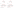

   Two labellings of one meaning each.  The triol's three units are searched and the two are equal; the
   heptol's seven exceed the search and they are not: its middle three carry the triol's two labellings,
   its outer four an AND group each.

Each figure below draws every meaning with that many worlds from its first string; the bold line is
the drawn world.

.. testcode::

    def cells(worlds):
        """The figure cells of every meaning with that many worlds, each drawn from its first string."""
        return [(zigzag(min(written)), alternatives(m)) for m, written in table if worlds(len(m[1]))]

    svg = grid(cells(lambda n: n == 1))

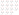

   No OR group: fifteen meanings, each one world.

.. testcode::

    svg = grid(cells(lambda n: n == 2))

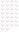

   Thirty meanings with two worlds.

.. testcode::

    svg = grid(cells(lambda n: n > 2))

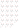

   Twenty-three meanings with three or four worlds.

Format support
--------------

==============  =========  =========  ==========================================================
Format          Read       Write      Note
==============  =========  =========  ==========================================================
V3000           both       both       ``MDLV30/STE*`` with ``ATOMS=``, ``MDLV30/STEB*`` with
                                      ``BONDS=``; an axis is named by its chain midpoint, an atom
                                      for an allene and a bond otherwise, an atropisomer or a helix
                                      by its anchor, and an AND or OR collection clears the record's
                                      chiral flag
V2000           label      neither    the chiral flag is one bit for the whole record, with no way
                                      to state which collection an atom is in.  A ``STEREOLABEL``
                                      data S-group states the partition outside the spec and the
                                      reader promotes one; the writer states no collection of its
                                      own and logs ``v2000:enhanced-stereo-not-written``, while a
                                      label already on the molecule is written as the data record it
                                      is -- so a file that came in this way goes back out and reads
                                      the same (:doc:`io`)
pach v3/v4      both       both       an atom-group block and a bond-group block, split by owner
                                      count, one namespace
pach v0/v2      neither    neither    the format is frozen; ``pack(version=2)`` raises
                                      ``ValueError`` naming ``stereo_groups``
MRV             both       both       ``mrvStereoGroup`` is an ``atomArray`` column, so an axis is
                                      named by its anchor atom
CXSMILES        both       both       ``|&N:|`` and ``|oN:|`` take atom indices, so an axis is named
                                      by one owner: the owner of lowest canonical position that owns
                                      no second unit.  The axis's own configuration is a ``wU:`` or
                                      ``wD:`` wedge in the same tail
==============  =========  =========  ==========================================================

V2000 is a lossy writer for enhanced stereo, by design: it writes every sign and states no collection,
ABS included, so a labelled molecule reads back unlabelled.

.. testcode::

    cells = []
    for tail in ('', ' |a:1|', ' |&1:1|', ' |o1:1|'):
        m = wedged('C[C@H](O)CC' + tail)
        log = []
        back = mdl(mdl(m, version=2000, log=log))
        rules = ['logged: not written'] if any('enhanced' in r.rule for r in log) else []
        cells += [(m, ['drawn', *groups(m)]),
                  (back, ['V2000 read back', *groups(back), f'== drawn: {back == m}', *rules])]
    svg = grid(cells, columns=4)

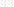

   Butan-2-ol under each kind, written to V2000 and read back.  Only the unlabelled record
   survives.

V3000 names a centre by ``ATOMS=`` and a double bond by ``BONDS=`` in two collections, so an AND or OR
group holding both is written as two groups of its kind, and the read-back is another meaning: the
two phases no longer move together.

.. testcode::

    m = wedged('C/C=C/[C@H](O)CC |&1:1,3|')
    log = []
    back = mdl(mdl(m, log=log))
    svg = grid([(m, ['drawn', *groups(m)]),
                (back, ['V3000 read back', *groups(back), f'== drawn: {back == m}',
                        *sorted({r.rule for r in log if 'split' in r.rule})])], columns=2, ids=True)

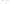

   A C=C and a centre in one AND group, written to V3000 and read back as two.

A SMILES string has no token for an atropisomer axis.  CXSMILES states it as a ``wU:a.b`` or
``wD:a.b`` wedge in the tail -- ``a`` the narrow end, ``b`` the bond, both 0-based, a ring closure
counted at its closing digit -- on a ring bond at a pivot, read without coordinates:

=========================  ==================================================================
Reads as                   When
=========================  ==================================================================
WEDGE at a pivot           the ring bond to its lower-index neighbour is wedged, or the other
                           ring bond is hashed; the converse is DASH
counterclockwise           WEDGE at the pivot written first, or DASH at the other; the
                           converse is clockwise.  RDKit reads the two as ``STEREOATROPCCW``
                           and ``STEREOATROPCW``
=========================  ==================================================================

A tail that also carries coordinates has its wedges logged ``smiles:cx-wedge-not-applied``, as does a
wedge that names no axis.  Plain SMILES (``!x``) writes the atoms without the axis and logs LOST
``smiles:stereo-not-written``; MOL keeps the axis as a drawn wedge.

.. testcode::

    from chython.core._core import write_smiles

    biaryl = smiles('Cc1cccc(O)c1-c1c(C)cccc1O')
    biaryl.set_parity(8, 1)
    biaryl.clean2d()
    cx, plain = [], []
    text = write_smiles(biaryl, '', log=cx)
    flat = write_smiles(biaryl, '!x', log=plain)
    assert text.endswith('|wU:0.0|') and not cx, text
    assert [r.rule for r in plain] == ['smiles:stereo-not-written']
    svg = grid([(biaryl, ['drawn', 'axis 8-9 configured']),
                (mdl(mdl(biaryl)), ['MOL read back', f'== drawn: {mdl(mdl(biaryl)) == biaryl}']),
                (smiles(text), ['CXSMILES read back', f'== drawn: {smiles(text) == biaryl}']),
                (smiles(flat), ['SMILES read back', f'== drawn: {smiles(flat) == biaryl}',
                                f'{len(plain)} writer record'])], columns=4)

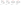

   6,6'-Dimethylbiphenyl-2,2'-diol with its axis configured, read back from MOL, from CXSMILES and
   from plain SMILES.

A helicene of five or more angular rings is one helix, owned by its two fjord atoms -- the terminal
rings' inner-rim CH atoms.  Parity 1 is the M helix and 2 the P helix.  The helix is written by the
axis table with the fjord atoms as the pivots, on each fjord atom's bond to its inner-rim fusion atom
and drawn narrow at the fusion atom, as IUPAC draws a helicene; that wedge states the converse of the
one the table puts at the fjord atom.  A MOL wedge is read the same way.  CXSMILES has no helix
spelling of its own, so this is chython's use of the axis table:

=========================  ==================================================================
Case                       Rule
=========================  ==================================================================
a fjord atom is also an    axes are written first, and the helix goes to its other end, since
axis pivot                 a bond carries one wedge
the wedges at the two      logged ``wedge:helix-contradictory`` (MOL) or
ends disagree              ``smiles:cx-wedge-contradictory``; the helix stays unset
InChI                      no layer for a helix: omitted, logged LOST
                           ``inchi:stereo-kind-not-represented``
=========================  ==================================================================

.. testcode::

    from chython.core._core import write_smiles

    helicene = smiles('c1ccc2c(c1)ccc1ccc3ccc4ccc5ccccc5c4c3c12')
    helix = next(u for u in helicene.stereo_units() if u['stereogenic'])
    helicene.set_parity(helix['anchor'], 2)
    helicene.clean2d()
    text = write_smiles(helicene)
    mirror = smiles(text.replace('wU', 'wX').replace('wD', 'wU').replace('wX', 'wD'))
    assert smiles(text) == helicene != mirror
    svg = grid([(helicene, ['P helix', f"owners {', '.join(map(str, helix['owners']))}"]),
                (smiles(text), ['CXSMILES read back', f'== drawn: {smiles(text) == helicene}']),
                (mirror, ['wedge inverted', f'== drawn: {mirror == helicene}'])], columns=3, ids=True)

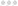

   [6]Helicene as the P helix, read back from CXSMILES and with its wedge inverted.

A planar unit is a substituted ring atom whose face a second layer screens, owned by that atom alone:
one unit per substituted atom.  Its parity is the signed volume of its four references, in order:

=========================  ==========================================  ============================
Shape                      References                                  Wedge
=========================  ==========================================  ============================
metallocene                substituent, metal, both ring neighbours    ring atom to the metal
[2.2]paracyclophane        substituent, bridge atom, bridgehead,       bridgehead to its bridge
                           other ring neighbour                        atom
trans-cycloalkene, 8- or   each terminal's ring neighbour and          the anchor to its ring
9-ring                     hydrogen, the anchor's first                neighbour; CXSMILES reads
                                                                       either terminal's
=========================  ==========================================  ============================

=========================  ==================================================================
Case                       Rule
=========================  ==================================================================
metallocene spelling       dative ``~`` bonds and ten single M-C bonds perceive one unit;
                           separate ions perceive none, and 3-D coordinates that put another
                           component on a ring face log ``wedge:hapto-not-bonded``
cycloalkene not trans      every C=C of an 8- or 9-ring is a candidate, dead unless its
                           cis/trans unit is trans; the anchor is the terminal in the later
                           slot, and a CXSMILES collection member is written on the terminal
                           written later
two layers, two            pseudo-para 4,16-dibromo[2.2]paracyclophane is its own mirror
substituents               image; pseudo-ortho 4,12 is not
InChI                      no layer for a planar unit: omitted, logged LOST
                           ``inchi:stereo-kind-not-represented``
CIP                        no Rp/Sp descriptor
=========================  ==================================================================

.. testcode::

    from chython.core._core import write_smiles

    cells = []
    for name, text in (('4-carboxy[2.2]paracyclophane', 'OC(=O)c1cc2ccc1CCc1ccc(cc1)CC2'),
                       ('(E)-cyclooctene', 'C1CCC/C=C/CC1')):
        m = smiles(text)
        unit = next(u for u in m.stereo_units() if u['kind'] == 5)
        m.set_parity(unit['anchor'], 1)
        m.clean2d()
        back = smiles(write_smiles(m))
        mirror = m.copy()
        mirror.set_parity(unit['anchor'], 2)
        assert back == m != mirror
        cells.append((m, [name, f"anchor {unit['anchor']}", f'== mirror: {m == mirror}']))
    svg = grid(cells, columns=2, ids=True)

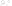

   Two planar units at parity 1, each unequal to its mirror image.

An atom-only member list, and the one axis it cannot name
---------------------------------------------------------

CXSMILES ``|&N:|`` and ``|oN:|``, and MRV's ``mrvStereoGroup``, take atom indices and nothing else, so
an axis -- named by two owners -- has one atom to speak for it.  ``set_stereo_group(atom, kind,
group)`` resolves an index to the unit anchored there or, failing that, to a unit that owns the atom,
so either an owner or the anchor round trips and an allene, whose anchor is neither owner, needs no
second spelling.

Which of the two the CXSMILES writer names is decided by canonical position among the owners and never
by the anchor, because the anchor is the slot the arena happened to choose: muconic acid with both C=C
axes in ``AND 1`` writes ``|&1:2,5|`` from every spelling of it, and a tail read back is written the
same way again.

An atom that owns two units names neither of them.  Where both owners of an axis do, the lower one is
written anyway -- a token is never suppressed on a prediction -- and the axis is reported
``smiles:stereo-group-axis-ambiguous``: the index carries the collection, and which of that atom's two
elements the collection is on is what it cannot carry.  ``C12=CC=CC=CC=C1C.CC1=CC=CC=CC=C12`` with its
axis configured is the case, its pivots being atropisomer owners and ring cis/trans terminals at once.

.. testcode::

    from chython.core._core import write_smiles

    muconic = smiles('OC(=O)/C=C/C=C/C(=O)O')
    with muconic.edit() as e:
        for pair in muconic.chiral_bonds():
            e.set_stereo_group(pair, 3, 1)
    bicycle = smiles('C12=CC=CC=CC=C1C.CC1=CC=CC=CC=C12')
    bicycle.set_parity(18, 1)
    with bicycle.edit() as e:
        e.set_stereo_group((1, 18), 2, 1)
    log = []
    write_smiles(bicycle, '', log=log)
    svg = grid([(muconic, ['muconic acid, both axes &1', f'str: {muconic}']),
                (bicycle, ['one o1 on an axis', 'written ' + format(bicycle, 'i').split()[-1],
                           *sorted({r.rule for r in log if 'axis' in r.rule})])], columns=2)

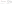

   Muconic acid names each axis by one owner.  The bicycle's axis is written on an
   atom that also owns a ring double bond, and is reported.

Limits
------

==========================  ==============================================================================
Limit                       Behaviour
==========================  ==============================================================================
``stereo_truncated``        True when the symmetry search ran out of budget; the stereogenic flags are then
                            an over-approximation.  Per molecule; explicit hydrogens on a large symmetric
                            ring reach it, ``test_a_connected_record_can_still_exhaust_the_budget`` in
                            ``chython/core/test/test_stereo_perception.py`` is the case
``identity_approximate``    True when a block of groups holds more than five units or the molecule more
                            than 1000 atoms; only AND phases are searched and one meaning can have two
                            identities (`Labelled drawings`_)
not perceived               an amine nitrogen outside the rule of `Stereo units`_, a P-H or N-H centre,
                            oxonium, bismuthine, a ring C=C below 8 atoms, a bond of an alternating cycle,
                            a biaryl pivot carrying hydrogen
metals                      a four-coordinate metal is a tetrahedral centre; ``@SP``, ``@TB`` and ``@OH``
                            read unconfigured, LOST ``smiles:chiral-class-unsupported``; a metallocene
                            written as separate ions perceives no planar unit
``assign_cip()``            rules 1a, 1b and 2; no Rp/Sp, no axial Ra/Sa or M/P, no r/s; a centre the
                            rules do not decide stays ``None`` and logs ``cip:undecided``
InChI                       a configured atropisomer axis is not written and logs nothing; a helix and a
                            planar unit are omitted, LOST ``inchi:stereo-kind-not-represented``
MOL after ``clean2d()``     a trans-cycloalkene is drawn cis and reads back Z; an extended cis/trans chain
                            ``C/C=C=C=C/C`` reads back unset, ``wedge:no-partner-terminal``
plain SMILES                atropisomer, helix and planar units are not written,
                            LOST ``smiles:stereo-not-written``; CXSMILES carries them as ``wU``/``wD``
==========================  ==============================================================================

.. testcode::

    from chython.core._core import write_smiles

    for text in ('CN(CC)CCC', 'C[P@H](CC)=O', 'C[Bi](CC)c1ccccc1', 'C1CCC=CCC1', 'CC1CN1C',
                 'C[P@](CC)CCC', 'C1CCCC=CCC1'):
        m = smiles(text)
        print(f'{text:20} {[u["kind"] for u in m.stereo_units() if u["stereogenic"]]}')
    log = []
    print(write_smiles(smiles('C[Pt@SP1](F)(Cl)Br', log=log)), sorted({r.rule for r in log}))

.. testoutput::

    CN(CC)CCC            []
    C[P@H](CC)=O         []
    C[Bi](CC)c1ccccc1    []
    C1CCC=CCC1           []
    CC1CN1C              [0, 0]
    C[P@](CC)CCC         [0]
    C1CCCC=CCC1          [1]
    C[Pt](F)(Cl)Br ['smiles:chiral-class-unsupported']

Auditing labels
---------------

``chython.chemistry.audit_stereo(molecule)`` reports what each sign and each stereo group of a drawing
states, as a ``StereoAudit`` of ``Finding`` records.  It is a reader: the molecule is not changed and
``molecule.log`` is not written.  ``StereoAudit.clean`` is True when no finding is above ``info``.

========  ==============================================================================================
Field     Content
========  ==============================================================================================
code      ``stereo-audit:<code>``, or the rule of a ``read`` row of `Index of stereo log rules`_
severity  ``error``, ``warning`` or ``info``
atoms     the units the finding is about; an axis is its owner pair
group     ``(kind, id)`` of the stored group concerned, a tuple of them for ``and-split``, or None
because   the units that motivate it: a bridgehead's partners, the unit a sign waits for
message   the code's template sentence, formatted
fixes     ``Fix(action, atoms, args, preserves_meaning, result)``; ``result`` is ``str()`` of the fixed copy
========  ==============================================================================================

===========================================  ========  ===============================================================
Code                                         Severity  Condition
===========================================  ========  ===============================================================
``stereo-audit:unknown-unit``                info      a stereogenic unit is unsigned and signing it moves the meaning
``stereo-audit:unlabelled-sign``             warning   a sign has no group beside AND or OR groups in its component
``stereo-audit:dead-unconfigured``           warning   a group member has no sign
``stereo-audit:dead-not-stereogenic``        warning   a signed group member has one configuration
``stereo-audit:dead-waits-for``              warning   a sign counts only once an unsigned unit of its rings is signed
``stereo-audit:dead-restating-group``        warning   inverting every member of the group gives the same molecule
``stereo-audit:and-single-member-racemate``  info      a one-member AND is on its component's only live unit
``stereo-audit:and-split``                   warning   one component carries two or more AND groups
``stereo-audit:and-absorbed``                info      another group fixes an AND group's phase; it reads as ABS
``stereo-audit:meso-absolute``               info      an AND or OR group on a meso configuration; it reads as ABS
``stereo-audit:bridgehead-unrealisable``     error     no out,out bicycle realises the signed bridgehead pair
``stereo-audit:bridgehead-implied``          info      an unsigned bridgehead takes its sign from its partner
``stereo-audit:bridgehead-redundant-label``  warning   a bridgehead's label is weaker than its set's: AND > OR > ABS
``stereo-audit:bridgehead-half-labelled``    warning   a bridgehead without the label its set carries elsewhere
``stereo-audit:bridgehead-merged-groups``    warning   a bridgehead's group is another of its set's kind; they merge
``stereo-audit:identity-approximate``        info      a block of groups exceeds the labelling search limit
``stereo-audit:truncated``                   info      search budget hit; stereogenicity is over-approximated
===========================================  ========  ===============================================================

A fix with ``preserves_meaning=True`` leaves ``==``, ``hash`` and ``str()`` unchanged, and it is the only
fix applied without asking; every other fix chooses an intent the drawing does not state.

One fact is named by one finding:

=========================================  ===================================================================
Finding                                    Suppresses on the same units
=========================================  ===================================================================
``stereo-audit:dead-waits-for``            the ``dead-*`` label finding of the waiting sign, and the
                                           ``unknown-unit`` of the unit it waits for, whose set-sign fixes it
                                           carries
``stereo-audit:bridgehead-unrealisable``   every other ``stereo-audit:`` finding on either bridgehead
``stereo-audit:unknown-unit`` on the       the ``unknown-unit`` of each unsigned partner, named in ``because``;
lowest member of an unsigned coupled       signing one member decides the set
bridgehead set
=========================================  ===================================================================

A read-time record in ``molecule.log`` passes through, without fixes, when its rule is a ``read`` row of
`Index of stereo log rules`_; any other record, such as ``smiles:cx-label-bad-index``, does not.
``stereo:bridgehead-unrealisable`` is the audit's own ``bridgehead-unrealisable``.  Records passed through
are never suppressed.

2,6-Dimethylspiro[3.3]heptane (CID 21304360) with signed terminals and an unsigned centre: each terminal
sign counts only once the centre is signed.  Signing it is the fix.

.. testcode::

    from chython.chemistry import audit_stereo

    spiro = smiles('C[C@H]1CC2(C1)C[C@H](C)C2')
    report = audit_stereo(spiro)
    for f in report.findings:
        print(f.code, f.atoms, f.because)
    fix = report.findings[0].fixes[0]
    print(fix.action, fix.atoms, fix.args, fix.preserves_meaning)
    if audit_stereo(smiles(fix.result)).clean:
        print('clean')

.. testoutput::

    stereo-audit:dead-waits-for (2,) (4,)
    stereo-audit:dead-waits-for (7,) (4,)
    set-sign (4,) (1,) False
    clean

The names a caller sees in the log
-----------------------------------

Two destinations, and which one a record reaches follows from who produced it: a reader, a writer and
``depict`` take a ``log=`` list and record into that, while a seal has no such argument and records into
``molecule.log``.

On write, in the writer's ``log=`` list, what a format cannot spell and what is written instead:

=============================================  ==========================================================
Rule                                           When
=============================================  ==========================================================
``v2000:enhanced-stereo-not-written``          V2000 write; the molecule carries any live group, ABS
                                               included: the chiral flag is not an ABS label
``smiles:stereo-group-dead``                   CXSMILES write stating collections; one INFO per dead
                                               member, which is not written
``v2000:stereo-group-dead``                    V2000 write; one INFO per dead member, which neither sets
                                               the chiral flag nor asks for V3000
``v3000:stereo-group-dead``                    V3000 write; one INFO per dead member, left out of its
                                               ``STE*`` collection; an emptied collection is not written
``mrv:stereo-group-dead``                      MRV write; one INFO per dead member, which gets no
                                               ``mrvStereoGroup``
``sgroup:stereo-label-dead``                   V2000 or V3000 write; a ``STEREOLABEL`` data record none
                                               of whose atoms or bonds is a configured stereogenic unit
                                               is not written
``v3000:collection-split``                     V3000 write (AND and OR only -- ABS never splits);
                                               one collection holds both atom-spelled and bond-spelled
                                               members, so its bond half is written under a free id;
                                               when all 63 ids of the kind are taken both halves keep
                                               the id and read back as one collection
``v3000:collection-axis-unspelled``            V3000 write; no chain joins an axis member's owners,
                                               so it is named by the lower one as an atom
``smiles:stereo-group-axis-ambiguous``         CXSMILES write; both owners of an axis own a second
                                               stereo element, so the one index written for it names
                                               no single element; written on the lower owner anyway
``v2000:unlabelled-sign-flag``                 V2000 write; chiral flag 1 is written for a configuration
``v3000:unlabelled-sign-flag``                 in no collection, which other readers take as ABS; INFO
=============================================  ==========================================================

Two records come from an edit session, in ``molecule.log``, and neither drops a collection:

=============================================  ==========================================================
Rule                                           When
=============================================  ==========================================================
``edit:stereo-group-not-an-axis``              a group is stated on a pair no unit owns; the byte is
                                               kept as a label on the lower atom
``edit:stereo-group-anchor-taken``             the seal re-anchored a unit that carries a group onto an
                                               atom already stating one; the byte keeps the atom it is
                                               on as a label for the original collection, while the
                                               axis is still spelled under the collection that was
                                               already at the new anchor
=============================================  ==========================================================

A byte otherwise follows its unit through the seal: an edit that re-anchors an axis -- breaking the
ring double bond at a biaryl pivot frees that pivot, and the axis moves to it -- moves the
collection with it.  On this clean path the unit is identified by its owners, so an atom owning two
units retains the right collection for each.

Three records come from an answer rather than an edit, in ``molecule.log``:

=============================================  ==========================================================
Rule                                           When
=============================================  ==========================================================
``stereo:identity-approximate``                an identity (``==``, ``hash``, ``canonical_bytes``); a
                                               block of groups exceeds the labelling search, its labels
                                               are relabelled, not searched, and
                                               ``identity_approximate`` is True
``stereo:bridgehead-unrealisable``             an identity, SMILES or InChI write (LOST), once;
                                               two coupled bridgeheads
                                               carry signs no out,out bicycle realises, so both read
                                               as unknown; ``validate_stereo()`` clearing them
``stereo:bridgehead-racemate``                 ``validate_stereo(recover_racemate=True)`` (REPAIRED);
                                               such a pair read as the racemate
``stereo:racemate-unsigned``                   ``validate_stereo()`` (REPAIRED); an unsigned unit alone
                                               in an AND group given a sign
``inchi:enhanced-stereo-not-stated``           an InChI write (LOST); an AND or OR member's sign is not
                                               written, the rest come from the least labelling, so
                                               equal molecules write one InChI
``inchi:stereo-kind-not-represented``          an InChI write (LOST); a configured helix or planar unit
                                               has no InChI layer and is omitted
=============================================  ==========================================================

On V3000 read, where the collection block is parsed:

=============================================  ==========================================================
Rule                                           When
=============================================  ==========================================================
``v3000:collection-unknown``                   a collection name that is not an ``MDLV30/STE*`` tag
``v3000:collection-no-group``                  a numbered tag with no number, read as group 1
``v3000:collection-wrong-object``              an atom collection carrying ``BONDS=``, or the reverse
``v3000:collection-atom-ref``                  an atom index the CTAB does not have
``v3000:collection-bond-ref``                  a bond index the CTAB does not have
``v3000:collection-group-renumbered``          an id above 63, renumbered to the lowest free id
``v3000:collection-group-dropped``             an id above 63 with all 63 ids of its kind taken
``v3000:collection-namespaces-merged``         V3000 read; ``STERACn`` and ``STEBRACn`` share an id,
                                               so the bond one is read under a free id; when all 63
                                               ids of the kind are taken the two are read as one
                                               collection
``v3000:collection-duplicate-member``          an atom or bond in two collections; the first keeps it
``v3000:collection-member-unconfigured``       a member the drawing leaves unconfigured; the membership
                                               is kept; INFO
``v3000:chiral-flag-contradicts-collection``   chiral flag 1 beside a ``STERAC`` or ``STEREL``
                                               collection; the collections are kept; INFO
``ctab:chiral-flag-ignored``                   V2000 or V3000 read; chiral flag 1 and a configuration in
                                               no collection, which is stored without an ABS label; INFO
``ctab:stereo-out-of-range``                   a collection references an atom position past the block
``ctab:stereo-group-dropped``                  the setter refused the entry -- an invalid kind or
                                               group id, or a bond group whose two atom ids are equal;
                                               a pair no unit owns is **kept** as a label at the lower
                                               atom, not dropped, and logged
                                               ``edit:stereo-group-not-an-axis`` instead
=============================================  ==========================================================

On CXSMILES read, records the group field produces:

=============================================  ==========================================================
Rule                                           When
=============================================  ==========================================================
``smiles:stereo-group-malformed``              the group field cannot be parsed
``smiles:stereo-group-empty``                  the group names no atom
``smiles:stereo-group-bad-index``              the group names an out-of-range atom
``smiles:stereo-group-duplicate``              the group assigns one atom twice
``smiles:stereo-group-renumbered``             the id is outside 1..63, 0 included, renumbered to the
                                               lowest free id
``smiles:stereo-group-refused``                the setter refused the group
=============================================  ==========================================================

On read, a drawing or a string mark that states no configuration leaves the element unset.  Each is
LOST unless marked:

=============================================  ==========================================================
Rule                                           When
=============================================  ==========================================================
``wedge:either-bond``                          an either (wavy) bond at a centre, on a double bond or at
                                               its terminal; it wins over 3D coordinates and the atom
                                               parity field
``wedge:drawing-field-disagree``               the drawing and the atom parity field disagree, or an
                                               either bond unsets a centre the field configures
``wedge:same-side-substituents``               both substituents of a double-bond terminal drawn on one
                                               side (IUPAC ST-4.1)
``wedge:ambiguous-drawing``                    turning one drawn bond by 5 degrees inverts the sign
``wedge:on-double-bond``                       an up or down wedge on a double bond that is neither at a
                                               tetrahedral centre nor at an atropisomer pivot
``wedge:hash-between-centres``                 a hashed bond joins two centres (IUPAC ST-0.5); read at
                                               its narrow end; INFO
``wedge:3d-wedge-overridden``                  in 3D, a wedge reads the opposite of the coordinates,
                                               which win
``wedge:atropisomer-unsupported-mark``         an axis wedge on the pivot bond or on an ortho
                                               substituent, not on a ring bond at a pivot (IUPAC ST-1.7)
``wedge:helix-contradictory``                  the wedges at the two ends of a helix state both senses
``wedge:hapto-not-bonded``                     in 3D, an atom of another component sits over a
                                               five-membered ring's face with no bond to state it
``ctab:dimensionality-mismatch``               the header's ``2D``/``3D`` stamp disagrees with the z
                                               coordinates; INFO
``smiles:stereo-same-side``                    two ``/`` or ``\`` marks put both substituents of one
                                               terminal on one side
``smiles:cx-wavy-bond``                        a ``@`` at an atom the CXSMILES ``w:`` field starts a wavy
                                               bond from
``smiles:cx-cis-trans-unknown``                a double bond named by ``ctu:``, or with a ``w:`` terminal
``smiles:cx-wavy-bad-index``                   ``w:`` names an atom the string does not have
``smiles:cx-ctu-bad-index``                    ``ctu:`` names a bond the string does not have
``smiles:cx-wedge-not-applied``                a ``wU:``/``wD:`` wedge that names no atropisomer axis,
                                               helix or planar unit, or any wedge in a tail that carries
                                               coordinates
``smiles:cx-wedge-bad-index``                  ``wU:``/``wD:`` names an atom or a bond the string does
                                               not have
``smiles:cx-wedge-contradictory``              the wedges on one axis or helix state both configurations
=============================================  ==========================================================

A ``STEREOLABEL`` promotion is a seal-time repair rather than a parse, so its two records land in
``molecule.log``:

=============================================  ==========================================================
Rule                                           When
=============================================  ==========================================================
``sgroup:stereo-label-promoted``               a label named a collection and the record stated none, so
                                               the collection was created from it
``sgroup:stereo-label-not-promoted``           the label was read and left as data: the record already
                                               states a collection, or the word names none (``E``, ``&``),
                                               or the labelled atom carries no configuration for a
                                               membership to be about
=============================================  ==========================================================

``clean_stereo_groups()`` drops every membership and keeps every parity, which is the call for a caller who
wants the configurations a promotion found and not the partition it inferred.

The MRV sample carries an axis through a format whose member list is atom-only:

.. testcode::

    from chython import smiles, mrv

    mol = smiles('COC(=O)/C=C\\C(=O)OC')
    with mol.edit() as e:
        e.set_bond_stereo_group(5, 6, 2, 1)
    back, = mrv(mrv(mol))
    print(back.bond_stereo_groups())

.. testoutput::

    {(2, 1): [(5, 6)]}

Index of stereo log rules
-------------------------

Every stereo record ``chython/`` emits.  A ``read`` record goes to the reader's ``log=`` list and to
``molecule.log`` at stage ``read``; a ``write`` record goes only to the writer's ``log=``; a ``depict``
record goes to depict's ``log=``; every other stage is a ``molecule.log`` stage.

==============================================  ================  =============  =======================================
Rule                                            Severity          Stage          When
==============================================  ================  =============  =======================================
``smiles:stereo-unknown``                       LOST              read           ``@?``: no state for a stated but
                                                                                 unresolved sign
``smiles:chiral-class-unsupported``             LOST              read           ``@SP``, ``@TB`` or ``@OH``; the
                                                                                 configuration is dropped
``smiles:stereo-no-unit``                       LOST              read           a sign on an atom that anchors no unit
``smiles:stereo-unit-incomplete``               LOST              read           a sign over fewer directions than the
                                                                                 unit orders
``smiles:stereo-too-many-dirs``                 LOST              read           a sign over more than four directions
``smiles:stereo-ambiguous-h``                   LOST              read           a sign on an atom with two hydrogens
``smiles:stereo-unsupported-unit``              LOST              read           a sign on a unit whose frame the reader
                                                                                 does not build
``smiles:stereo-allene-bad-bonds``              LOST              read           an allene sign on a centre without two
                                                                                 double bonds
``smiles:stereo-allene-overfilled``             LOST              read           an allene terminal with more than two
                                                                                 substituents
``smiles:stereo-one-sided``                     LOST              read           a double bond with ``/`` or ``\`` on
                                                                                 one side only
``smiles:stereo-same-side``                     LOST              read           both substituents of one terminal
                                                                                 marked on one side
``smiles:stereo-unused-dirs``                   LOST              read           ``/`` or ``\`` marks that configure
                                                                                 nothing
``smiles:doubled-bond-direction``               REPAIRED          read           a direction token written twice, read
                                                                                 as one
``smiles:ring-bond-dir-conflict``               REPAIRED          read           a ring closure with opposite
                                                                                 directions; the opening wins
``smiles:cx-wavy-bond``                         LOST              read           a sign at an atom a ``w:`` wavy bond
                                                                                 starts from
``smiles:cx-wavy-bad-index``                    LOST              read           ``w:`` names an atom the string does
                                                                                 not have
``smiles:cx-cis-trans-unknown``                 LOST              read           a double bond named by ``ctu:`` or with
                                                                                 a ``w:`` terminal
``smiles:cx-ctu-bad-index``                     LOST              read           ``ctu:`` names a bond the string does
                                                                                 not have
``smiles:cx-wedge-not-applied``                 LOST              read           a ``wU:``/``wD:`` naming no axial-like
                                                                                 unit, or beside coordinates
``smiles:cx-wedge-bad-index``                   LOST              read           ``wU:``/``wD:`` names a missing atom or
                                                                                 bond
``smiles:cx-wedge-contradictory``               LOST              read           the wedges on one axis or helix state
                                                                                 both senses
``smiles:cx-relative-flag-redundant``           INFO              read           an ``r`` flag beside a group that
                                                                                 already states it
``smiles:cx-relative-flag-unbacked``            LOST              read           an ``r`` flag with no group; signs
                                                                                 stored absolute
``smiles:stereo-group-malformed``               LOST              read           the group field cannot be parsed
``smiles:stereo-group-empty``                   INFO              read           a group naming no atom
``smiles:stereo-group-bad-index``               LOST              read           a group naming an out-of-range atom
``smiles:stereo-group-duplicate``               LOST              read           one atom assigned twice
``smiles:stereo-group-renumbered``              REPAIRED          read           an id outside 1..63, renumbered
``smiles:stereo-group-refused``                 LOST              read           the setter refused the group
``smiles:cip-field-malformed``                  LOST              read           a ``{...}`` CIP field that cannot be
                                                                                 parsed
``smiles:cip-field-bad-descriptor``             LOST              read           a CIP field naming no descriptor
``smiles:cip-undetermined``                     INFO              read           a CIP field stating no determination
``smiles:cip-bad-index``                        LOST              read           a CIP field naming a missing atom
``smiles:cip-duplicate``                        LOST              read           two descriptors for one atom; the first
                                                                                 is kept
``smiles:cip-refused``                          LOST              read           a descriptor the atom cannot store
``smarts:unresolved-stereo-dropped``            LOST              read           ``@?`` in a query, which no match can
                                                                                 test
``smiles:stereo-not-written``                   LOST              write          plain SMILES: an atropisomer, helix or
                                                                                 planar sign
``smiles:stereo-not-stereogenic``               INFO              write          a parity on a unit that is not
                                                                                 stereogenic
``smiles:stereo-group-dead``                    INFO              write          a dead group member, not written
``smiles:stereo-group-axis-ambiguous``          LOST              write          an axis whose owners each own a second
                                                                                 unit
``inchi:stereo-kind-not-represented``           LOST              inchi          a configured helix or planar unit
``inchi:enhanced-stereo-not-stated``            LOST              inchi          an AND or OR member, whose sign is not
                                                                                 stated
``stereo:bridgehead-unrealisable``              LOST              stereo         coupled bridgehead signs no bicycle
                                                                                 realises; once
``stereo:bridgehead-racemate``                  REPAIRED          stereo         such a pair read as the racemate
``stereo:racemate-unsigned``                    REPAIRED          stereo         an unsigned AND singleton given a sign
``stereo:identity-approximate``                 INFO              stereo         a group block past the labelling search
``stereo-groups:dead``                          INFO              stereo-groups  a member stating no configuration,
                                                                                 dropped
``stereo-groups:not-stereogenic``               INFO              stereo-groups  a parity on a non-stereogenic unit,
                                                                                 dropped
``stereo-groups:relabelled``                    INFO              stereo-groups  a member moved to its least label
``stereo-groups:phase``                         INFO              stereo-groups  an AND group inverted into its
                                                                                 canonical phase
``stereo-groups:wedge-dropped``                 INFO              stereo-groups  a wedge on an unconfigured unit
``stereo-groups:cip-dropped``                   INFO              stereo-groups  a descriptor of the other phase
``edit:stereo-group-not-an-axis``               REPAIRED          edit           a group on a pair no unit owns, kept as
                                                                                 a label
``edit:stereo-group-anchor-taken``              LOST              edit           a re-anchored unit lands on an atom
                                                                                 with a group
``container:cip-dropped``                       LOST              edit:cip       an edit invalidated stored descriptors
``ctab:wedge-dropped``                          LOST              read           a wedge the setter refused
``ctab:configuration-out-of-range``             LOST              read           a stated configuration naming a missing
                                                                                 atom
``ctab:stereo-out-of-range``                    INFO              read           a collection naming a missing atom
``ctab:stereo-group-dropped``                   LOST              read           a collection entry the setter refused
``ctab:chiral-flag-ignored``                    INFO              read           chiral flag 1 with no collection; not
                                                                                 read as ABS
``ctab:dimensionality-mismatch``                INFO              read           the ``2D``/``3D`` stamp disagrees with
                                                                                 z
``v2000:bad-bond-stereo``                       LOST              read           bond stereo not 0, 1, 3, 4 or 6
``v2000:cis-or-trans-on-non-double``            INFO              read           stereo 3 on a bond that is not double
``v2000:stereo-care``                           LOST              read           the stereo care box, a query field
``v2000:chiral-flag-contradicts-collection``    INFO              read           chiral flag 1 beside an AND or OR
                                                                                 collection
``v3000:chiral-flag-contradicts-collection``    INFO              read           chiral flag 1 beside an AND or OR
                                                                                 collection
``v3000:bond-bad-cfg``                          LOST              read           ``CFG=`` not a wedge code
``v3000:collection-unknown``                    LOST              read           a collection that is not
                                                                                 ``MDLV30/STE*``
``v3000:collection-no-group``                   REPAIRED          read           a numbered tag with no number, read as
                                                                                 1
``v3000:collection-wrong-object``               LOST              read           atoms in a bond collection or the
                                                                                 reverse
``v3000:collection-atom-ref``                   LOST              read           a missing atom index
``v3000:collection-bond-ref``                   LOST              read           a missing bond index
``v3000:collection-group-renumbered``           REPAIRED          read           an id above 63, renumbered
``v3000:collection-group-dropped``              LOST              read           an id above 63 with every id taken
``v3000:collection-namespaces-merged``          REPAIRED or LOST  read           atom and bond collections sharing an
                                                                                 id; LOST when no id is free
``v3000:collection-duplicate-member``           LOST              read           a member of two collections
``v3000:collection-member-unconfigured``        INFO              read           a member the drawing leaves unset
``sgroup:stereo-label-promoted``                REPAIRED          read           a ``STEREOLABEL`` became a collection
``sgroup:stereo-label-not-promoted``            INFO or LOST      read           a ``STEREOLABEL`` left as data; LOST
                                                                                 when its word names nothing
``v2000:enhanced-stereo-not-written``           LOST              write          V2000 cannot state a group
``v2000:stereo-group-dead``                     INFO              write          a dead member, not written
``v3000:stereo-group-dead``                     INFO              write          a dead member, not written
``v2000:unlabelled-sign-flag``                  INFO              write          chiral flag 1 for signs in no
                                                                                 collection
``v3000:unlabelled-sign-flag``                  INFO              write          chiral flag 1 for signs in no
                                                                                 collection
``v3000:collection-split``                      LOST              write          one collection with atom and bond
                                                                                 members
``v3000:collection-axis-unspelled``             REPAIRED          write          an axis named by its lower owner as an
                                                                                 atom
``sgroup:stereo-label-dead``                    INFO              write          a ``STEREOLABEL`` on no configured unit
``wedge:either-bond``                           LOST              read           an either (wavy) bond
``wedge:drawing-field-disagree``                REFUSED           read           the drawing and a stated field disagree
``wedge:reanchored``                            REPAIRED          read           a wedge re-anchored at its wide end
``wedge:3d-wedge-overridden``                   LOST              read           in 3D a wedge contradicts the
                                                                                 coordinates
``wedge:no-coords-read``                        INFO              read           wedges and no coordinates; the parity
                                                                                 field is read
``wedge:hash-between-centres``                  INFO              read           a hash joining two centres; read at its
                                                                                 narrow end
``wedge:non-stereogenic``                       LOST              read           a wedge on a non-stereogenic centre
``wedge:on-double-bond``                        LOST              read           a wedge on a double bond
``wedge:undrawn-directions``                    LOST              read           a centre with too many undrawn
                                                                                 directions
``wedge:ambiguous-drawing``                     LOST              read           a 5 degree turn of one bond inverts the
                                                                                 sign
``wedge:ambiguous-parity-frame``                LOST              read           a parity field whose frame undrawn
                                                                                 bonds leave open
``wedge:degenerate-geometry``                   LOST              read           a degenerate layout of any kind
``wedge:collinear``                             LOST              read           a collinear double-bond layout
``wedge:same-side-substituents``                LOST              read           both substituents of a terminal on one
                                                                                 side
``wedge:no-partner-terminal``                   LOST              read           the double bond partner terminal not
                                                                                 found
``wedge:bad-letter``                            LOST              read           a stated configuration letter that is
                                                                                 none
``wedge:ambiguous-bare-letter``                 LOST              read           a C or T with no references on a
                                                                                 2-substituted terminal
``wedge:wrong-ref-count``                       LOST              read           a C or T over other than four atoms
``wedge:wrong-bond``                            LOST              read           a C or T measured over another bond
``wedge:wrong-substituent``                     LOST              read           a C or T naming a non-substituent
``wedge:allene-chain-ends``                     LOST              read           an allene chain without two ends
``wedge:allene-terminals``                      LOST              read           allene terminals not identified
``wedge:allene-one-direction``                  LOST              read           an allene terminal with one direction
``wedge:allene-both-terminals``                 LOST              read           wedges on both allene terminals
``wedge:allene-same-direction``                 LOST              read           both bonds of one terminal wedged alike
``wedge:atropisomer-pivots``                    LOST              read           the partner pivot not found
``wedge:atropisomer-both-pivots``               LOST              read           wedges on both pivots
``wedge:atropisomer-same-direction``            LOST              read           both ring bonds of one pivot wedged
                                                                                 alike
``wedge:atropisomer-unsupported-mark``          LOST              read           an axis wedge not on a ring bond at a
                                                                                 pivot
``wedge:helix-contradictory``                   LOST              read           the helix-end wedges state both senses
``wedge:hapto-not-bonded``                      LOST              read           in 3D an unbonded atom over a five-ring
                                                                                 face
``wedge:unsupported-kind``                      LOST              read           a kind the drawing reader does not read
``wedge:unsettled``                             LOST              read           the resolution did not settle
``wedge:no-coords-write``                       LOST              write          configured centres and no coordinates
``wedge:double-bond-no-coords``                 LOST              write          a cis/trans unit and no coordinates
``wedge:no-writable-bond``                      LOST              write          no bond carries a wedge that reproduces
                                                                                 the sign
``wedge:no-free-bond``                          LOST              write          every candidate bond already carries a
                                                                                 wedge
``wedge:ring-bond-wedge``                       INFO              write          centres wedged only on a ring bond
``wedge:crowded``                               INFO              write          centres sharing an atom with another
                                                                                 wedge
``cml:atom-parity-bad-value``                   LOST              read           ``atomParity`` not a number
``cml:atom-parity-wrong-ref-count``             LOST              read           ``atomRefs4`` not four atoms
``cml:atom-parity-unknown-atom``                LOST              read           ``atomParity`` naming a missing atom
``cml:atom-parity-phantom-twice``               LOST              read           the phantom direction named twice
``cml:bond-stereo-empty``                       LOST              read           an empty ``bondStereo``
``cml:bond-stereo-unknown-letter``              LOST              read           a ``bondStereo`` letter not modelled
``cml:bond-stereo-unknown-convention``          LOST              read           a ``bondStereo`` dictionary not read
``cml:bond-stereo-convention-value-bad``        LOST              read           a convention value not 0, 1, 3, 4 or 6
``cml:bond-stereo-cis-or-trans-unknown``        LOST              read           "cis or trans, unknown which"
``cml:bond-stereo-wrong-ref-count``             LOST              read           a cis/trans ``bondStereo`` not over
                                                                                 four atoms
``cml:bond-stereo-unknown-atom``                LOST              read           a cis/trans ``bondStereo`` naming a
                                                                                 missing atom
``cml:atom-parity-unwritable``                  LOST              write          a centre whose bonds name fewer than
                                                                                 four atoms
``mrv:bond-stereo-empty``                       LOST              read           an empty ``bondStereo``
``mrv:bond-stereo-bad-letter``                  LOST              read           a letter not W, H, C or T
``mrv:bond-stereo-bad-value``                   LOST              read           a convention value not a number
``mrv:bond-stereo-bad-code``                    LOST              read           a convention value not 0, 1, 3, 4 or 6
``mrv:bond-stereo-foreign-dict``                LOST              read           a ``bondStereo`` dictionary not read
``mrv:bond-stereo-cis-trans-unknown``           LOST              read           "cis or trans, unknown which"
``mrv:stereo-group-dead``                       INFO              write          a dead member, no ``mrvStereoGroup``
``mmcif:chem-comp-stereo``                      LOST              read           ``_chem_comp_bond`` stereo rows, not
                                                                                 modelled
``depict:rewedged``                             INFO              depict         a stored wedge reads the other sign in
                                                                                 this layout
``depict:unwedged``                             INFO              depict         no wedge could be drawn for a centre
``depict:crossed``                              INFO              depict         a collinear or degenerate C=C, drawn
                                                                                 crossed
``depict:crossed-contradiction``                INFO              depict         the layout draws the other C=C sign,
                                                                                 drawn crossed
==============================================  ================  =============  =======================================

Five families are documented with the pass that emits them:

==================================  ===============  ================
Rules                               Stage            Page
==================================  ===============  ================
``cip:*``                           ``cip``          :doc:`molecule`
``enrich:parity-*``                 ``enrich``       :doc:`molecule`
``pach:*-lost``                     ``pach``         :doc:`pach`
``heal:*``                          ``heal``         :doc:`reactions`
``reconstruct:stereo-mismatch``     ``reconstruct``  :doc:`reactions`
==================================  ===============  ================
